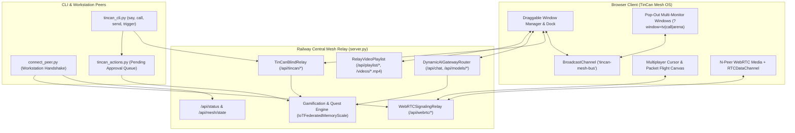
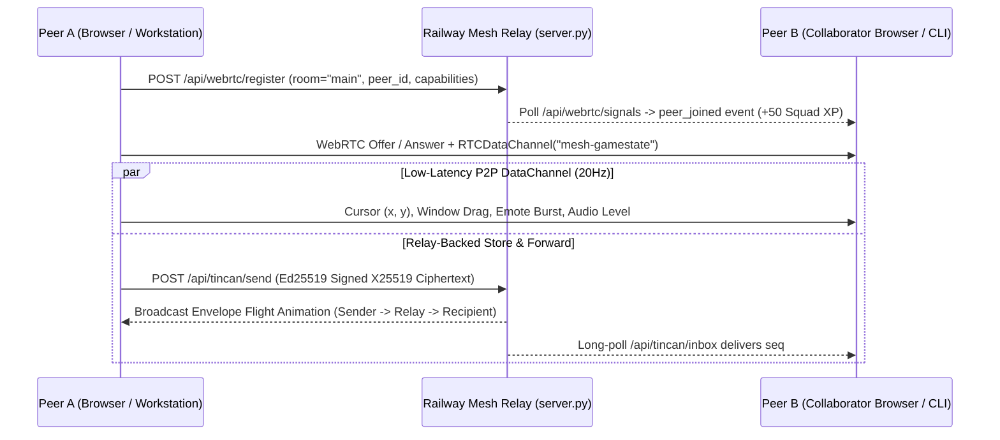
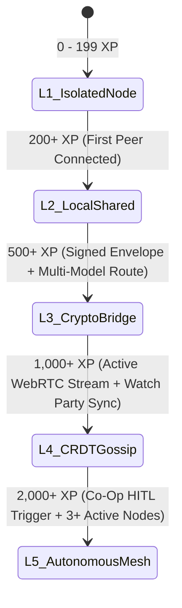

# TinCan Mesh OS — Multi-Window, Multiplayer & Gamified Experience Architecture

**Stage:** Architecture (AR) & Definition (DF)  
**Project Path:** `/tincan`  
**Status:** Active Blueprint  
**Component:** Hosted Web UI (`HTML_UI` in `server.py`), WebRTC Signaling (`webrtc_relay.py`), Blind Relay (`tincan_relay.py`), CRDT Mesh (`crdt_mesh.py`), AI Gateway (`ai_gateway.py`), & HITL Action Deck (`tincan_actions.py`)  
**Live Relay Endpoint:** `https://iot-federated-agent-memory-production.up.railway.app`  
**Repository:** `~/dev/iot-federated-agent-memory`

---

## 1. Executive Summary & Problem Statement

The currently hosted **TinCan Relay & IoT Federated Agent Mesh** (`server.py`) renders a static 12-column Tailwind dashboard containing:
1. A static Quickstart & one-line `curl` panel.
2. A self-hosted native HTML5 MP4 video collection player (`RelayVideoPlaylist`).
3. Four static summary metric cards (with hardcoded `L5: 94.5 / 100` readiness text).
4. An AI Model Gateway configuration and usage panel (`DynamicAIGatewayRouter`).
5. A 2-viewport (`localVideo` + `remoteVideo`) WebRTC studio (`WebRTCSignalingRelay`).

While the underlying Python backend already supports multi-peer WebRTC signaling, Ed25519/X25519 sealed store-and-forward mailboxes (`TinCanBlindRelay`), SHA-256/CRC32 framed CRDT delta gossip (`CRDTDeltaMessage`), and Human-In-The-Loop (HITL) peer command triggers (`tincan_actions.py`), the web interface treats every visitor as an isolated single-tab viewer.

**Goal:** Transform the hosted TinCan Relay page into **TinCan Mesh OS**—a draggable, multi-window, multi-monitor pop-out desktop environment with real-time multiplayer presence, synchronized media watch parties, visual cryptographic packet flight, and a cooperative **L1 $\rightarrow$ L5 Mesh Ascension** gamification loop.

---

## 2. System Architecture Overview

---

## 3. Pillar I: Multi-Window Desktop & Multi-Monitor Pop-Out Architecture

Instead of locking all panels into a single scrolling page, **TinCan Mesh OS** introduces a retro-futuristic spatial window manager with a persistent bottom dock, top telemetry HUD bar, and native multi-monitor pop-out support.

### 3.1 Core Window Applications

| Window App ID | Titlebar Name | Core Backend Binding | Multi-Window / Pop-Out Behavior |
| :--- | :--- | :--- | :--- |
| `win-terminal` | `⚡ Terminal & Quickstart.exe` | `/install.sh`, `/api/chat`, `/api/version` | Interactive command runner + 1-click `curl` copy & live JSON inspector |
| `win-comms` | `📹 Mesh Comms Studio.app` | `/api/webrtc/register`, `/api/webrtc/signal`, `/api/webrtc/signals` | Dynamic $N \times N$ peer video/voice/screenshare grid; supports Document PiP |
| `win-tv` | `📺 Relay TV Watch Party.app` | `/api/playlist`, `/api/playlist/add`, `/videos/*.mp4` | Synchronized room playback, auto-loop toggle, and floating emoji emitter |
| `win-mailbox` | `🥫 TinCan Cipher Mailbox.app` | `/api/tincan/send`, `/api/tincan/inbox`, `/api/tincan/whoami` | In-browser X25519/Ed25519 keypair generator, sealed message composer & inbox |
| `win-arena` | `🧠 AI Brain Router & Arena.app` | `/api/chat`, `/api/models/set`, `/api/models/analytics` | Side-by-side blind model battle (`claude-brain` vs `gemini-brain` vs `grok-brain` vs `openai-brain`) |
| `win-quests` | `🎯 HITL Action Deck & Quests.app` | `tincan_actions.py`, `scale.py`, `/api/status` | Interactive approval/dismiss cards for `tincan trigger` + L1–L5 Quest Board |

### 3.2 Multi-Monitor Pop-Out & Cross-Window Tether Sync

Every window titlebar includes `[ — ]` (Minimize to Dock), `[ □ ]` (Maximize/Tile), and `[ ↗ Pop Out ]`:
- Clicking **↗ Pop Out** opens `window.open('/?window=<appId>&room=<room>', '_blank', 'width=640,height=520')`.
- Every open window attaches to `new BroadcastChannel('tincan-mesh-bus')` and broadcasts `{ windowId, screenX, screenY, innerWidth, innerHeight, state }` on `requestAnimationFrame`.
- **Visual Tin-Can String Tethers:** When two or more TinCan windows are open side-by-side on a desktop, an SVG overlay renders a taut, vibrating "tin-can string" connecting the edges of the browser windows across the user's screen coordinate space, pulsing whenever audio or encrypted envelopes pass between them.

---

## 4. Pillar II: Real-Time Multiplayer Presence & Co-Op Canvas

### 4.1 Multiplayer Signaling & State Flow

### 4.2 Multiplayer Features

1. **Live Peer Cursors & Focus Badges:**
   - Connected browsers transmit normalized viewport coordinates `(x, y)` and `focusedWindowId` via `RTCDataChannel` (falling back to `/api/webrtc/signal` with `type: "cursor"`).
   - Peers see each other's labeled cursors (`alejandrolondono-MBP`, `Collaborator MacBook`) moving across the desktop and highlighting the window they are actively operating.
2. **Dynamic $N$-Peer WebRTC Mesh Grid:**
   - Upgrades the single `remoteVideo` element in `server.py` to a `Map<peerId, RTCPeerConnection>` so 2, 3, or 6+ peers can simultaneously stream camera, voice, or H.264 desktop screenshares inside `📹 Mesh Comms Studio.app`.
3. **Synchronized Watch Party (`📺 Relay TV`):**
   - Toggling **Co-Op Sync** locks all peers in the room to the host's `currentVideoIdx`, playback state (`play`/`pause`), and `currentTime`.
   - Clicking reaction buttons (`🔥`, `🥫`, `⚡`, `🧠`, `🚀`) spawns physics-driven floating particles across every connected peer's video player.
4. **Cryptographic Packet Flight Visualizer:**
   - The background canvas renders a live force-directed topology graph of all peers registered via `connect_peer.py` and WebRTC, plus the central Railway Relay node and the 4 funded AI Brain nodes.
   - Sending a sealed envelope via `/api/tincan/send` or dispatching an LLM prompt via `/api/chat` launches a visible neon packet along the graph edges with real-time latency (ms) and byte-size telemetry.

---

## 5. Pillar III: Gamification & L1 $\rightarrow$ L5 Mesh Ascension Loop

### 5.1 Readiness Tier Progression State Machine

Instead of displaying a static readiness string, the room's **Readiness Tier** dynamically levels up based on real metrics from `IoTFederatedMemoryScale` (`scale.py`) combined with live multiplayer session XP:

### 5.2 Cooperative Actions, XP Rewards & Badges

| Action / Event | Trigger Endpoint / Source | XP Awarded | Unlockable Badge / Visual Reward |
| :--- | :--- | :--- | :--- |
| **Workstation Handshake** | `connect_peer.py` or `POST /api/webrtc/register` | `+50 XP` | 🟢 **Mesh Initiate** — Unlocks Peer Radar Node |
| **Sealed Courier** | `POST /api/tincan/send` (Verified Ed25519 Signature) | `+100 XP` | 🥫 **Cipher Postmaster** — Neon Envelope Trail |
| **Inbox Decryption** | `GET /api/tincan/inbox` (`touch_presence` read ack) | `+75 XP` | 🔐 **Zero-Knowledge Reader** — Verified Seal Stamp |
| **AI Brain Arena Match** | Dual dispatch on `POST /api/chat` + peer vote | `+150 XP` | 🧠 **Synapse Arbiter** — Unlocks Cyber-Gold HUD Theme |
| **Curator Drop** | `POST /api/playlist/add` (New MP4 ingested) | `+125 XP` | 📺 **Broadcast DJ** — Custom Watch Party Emotes |
| **Co-Op HITL Trigger** | `tincan trigger <id>` via `tincan_actions.py` | `+200 XP` | ⚡ **Human-In-The-Loop Commander** — L5 Ascension Flair |

### 5.3 Live Leaderboard & Unlockable Desktop Themes

- **Mesh Operator Leaderboard:** Tracks per-peer session and cumulative stats (`xp`, `envelopes_sealed`, `tokens_routed`, `streams_hosted`, `actions_approved`) via `GET /api/mesh/leaderboard`.
- **Unlockable Visual Skins:** As the room ascends from **L1** to **L5**, operators unlock selectable desktop themes in the top status bar:
  - **Tier L1:** *Slate Standard* (Default dark slate)
  - **Tier L2:** *Amber Phosphor CRT* (Scanlines + monochrome amber glow)
  - **Tier L3:** *Cryptographic Emerald* (Matrix grid + animated cipher hex rain)
  - **Tier L4:** *WebRTC Cyan Pulse* (Glassmorphic neon window borders)
  - **Tier L5:** *AI Messiah Gold & Holographic* (Full particle canvas + synthesized WebAudio chord chimes)

---

## 6. Implementation Plan & File Touchpoints

| Phase | Target File | Changes Required |
| :--- | :--- | :--- |
| **Phase 1: Gamification & Presence API** | `iot_federated_agent_memory/tincan_relay.py` & `server.py` | Add `/api/mesh/state` and `/api/mesh/event` endpoints aggregating `tincan_relay.presence`, active WebRTC peers, XP ledger, active quests, and recent packet flight events. |
| **Phase 2: Multi-Window Desktop UI** | `server.py` (`HTML_UI`) | Replace static grid with draggable/resizable window manager, bottom application dock, top L1–L5 XP progress bar, and `?window=<id>` single-app pop-out mode synced via `BroadcastChannel`. |
| **Phase 3: Multiplayer Cursors, $N$-Peer WebRTC & Watch Party** | `server.py` (`HTML_UI` JS) | Upgrade `pc` singleton to `peerConnections[peerId]` map, wire `RTCDataChannel` + signal fallback for live peer cursors, watch-party timestamp sync, and emoji particle bursts. |
| **Phase 4: In-Browser TinCan Crypto & Model Arena** | `server.py` (`HTML_UI` JS) | Add WebCrypto / TweetNaCl-compatible envelope sender & inbox poller inside `🥫 TinCan Cipher Mailbox.app` and dual-model side-by-side comparison inside `🧠 AI Brain Router & Arena.app`. |
| **Phase 5: Verification & Railway Deploy** | `tests/` & `railway up` | Add unit tests for `/api/mesh/state` and XP progression, verify all existing `pytest` suites pass, and deploy to `https://iot-federated-agent-memory-production.up.railway.app`. |
