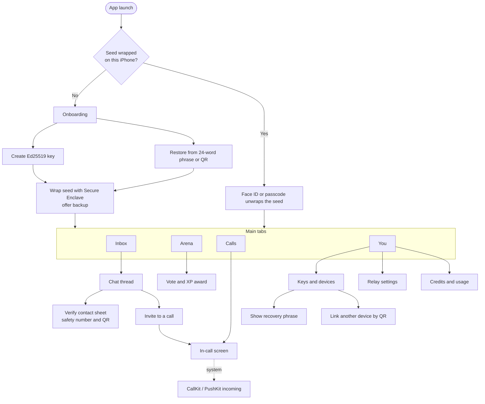

# TinCan 2.2 · native iOS app

Concepts and mockups only. No code, no builds, no commits. Grounded in the public repo [NoJuanNobody/tincan-skills](https://github.com/NoJuanNobody/tincan-skills) (TinCan 2.2.0) and in the Mesh OS zen-shell tokens already used for the car UI.

This is a purpose-built native app, not a wrapper around the Mesh OS web shell.

## What the app is for

TinCan is a zero-account identity: an Ed25519 key that becomes a `tc:` address, used to send NaCl-sealed, signed messages through a blind HTTPS relay that stores ciphertext only. The same identity signs up for Mesh OS work on that relay: AI Brain Arena duels (two models, a vote, L1–L5 XP), and 1:1 WebRTC audio, video, screen share, and data channels (STUN only). On iOS, inbox wakeups use push instead of the CLI’s long-poll, and calls use CallKit / PushKit. A plus is an OpenRouter credits and usage view, with any credits sold offered as an in-app purchase.

Default relay: `https://iot-federated-agent-memory-production.up.railway.app`.

Wire API (from `server.py`):

- `POST /api/tincan/send` — already-sealed envelope (`to` / `from` / `box` / `sig`)
- `GET /api/tincan/inbox?address=&since_seq=&timeout=` — ciphertext only; on iOS the `timeout` long-poll is not used
- `GET /api/tincan/whoami`
- `POST /api/mesh/arena/battle`, `POST /api/mesh/arena/vote`, `POST /api/mesh/xp/award`
- `POST /api/webrtc/register`, `/api/webrtc/signal`, `GET /api/webrtc/signals`, `POST /api/webrtc/leave`
- `GET /api/account/billing`, `POST /api/account/billing/topup` (top-up is surfaced as StoreKit, not a web checkout)
- `GET /api/version` reports `2.2.0` and the default relay URL

## Tab structure and navigation

Four tabs: **Inbox · Arena · Calls · You**.

Inbox is the home. Arena is the distinctive Mesh OS surface. Calls holds recents and starts a room. You holds the key, linked devices, backup, the relay, and credits — things people change rarely.

How a few paths feel:

- First launch never asks for an email or phone. Create a key, or restore one.
- Opening a thread from Inbox hides the tab bar and shows a sealed composer, which is the usual iOS pattern.
- Verify is a sheet over the thread, not a new tab.
- An incoming call is CallKit first. After accept, the in-app call screen takes over: audio, video, screen share, data channel.
- Buying credits happens on the Credits screen through an in-app purchase sheet, never a relay web form.

## Key UI patterns

- **Zen shell, dirtied.** Sumi ground, washi type, persimmon for seals, REC-like focus, and votes. Dirty gradients use two `feTurbulence` layers, pushed a little grittier than the car pass. Same incomplete-circle mark, Shippori Mincho for titles, Zen Kaku Gothic New for UI.
- **Native structure, TinCan chrome.** Tab bar, navigation bars, and sheets follow iOS habits. Icons are drawn for this kit — no Apple logos, no SF Symbols copied verbatim.
- **Sealed, not locked-with-a-brand.** Every thread carries a small mark and the line “Sealed to [name]’s key.” Unverified contacts get “Compare safety number” in washi, not a scary banner.
- **Glanceable identity.** The `tc:` address is always selectable and wraps. It is never truncated to the point it could be confused with another key.
- **Large, honest controls.** Primary actions (create key, vote, end call, buy credits, mark verified) are full-width and at least 52pt tall. Destructive or irreversible actions (reveal phrase, unlink a device, reset identity) sit behind a confirmation.
- **Motion and background stay quiet.** No animated grain in Reduce Motion. Call controls stay put. Arena answers scroll; the vote bar does not.

## Crypto identity and key management

### Onboarding and key creation

TinCan identities are local. `tincan whoami` on the desktop generates or loads a key in `~/.tin-can/` and prints a 52-character Base32 `tc:` address. The iOS app does the same job without a shell: it generates an Ed25519 signing key (from which X25519 is derived for sealed boxes, as `tincan_core` does) and shows the address immediately.

The first screen states the contract in plain language: a key, not an account. Two actions, Create and Restore. After create, the confirmation screen shows the new `tc:` address, explains that the private key never goes to the relay, and asks the person to lock it with Face ID or a passcode and to make a backup before they depend on it.

### Secure Enclave and Keychain (Ed25519 is not native)

The Secure Enclave does not implement Ed25519 or X25519. It implements NIST P-256 (CryptoKit `SecureEnclave.P256`). TinCan cannot sign envelopes *inside* the Enclave.

Recommended approach — **Enclave-wrapped seed**:

1. Generate a 32-byte Ed25519 seed in memory.
2. Create a P-256 key in the Secure Enclave, bound to biometry or the device passcode. That key never leaves the Enclave.
3. Wrap (ECIES-encrypt) the Ed25519 seed to the Enclave key. Store only the wrapped blob in the Keychain, ideally `WhenUnlockedThisDeviceOnly`.
4. On each send, decrypt, or call setup: Face ID or passcode, unwrap the seed into memory, sign and seal, then zero the bytes.
5. The portable copy of the seed is the 24-word recovery phrase (32 bytes maps cleanly onto BIP-39), shown only after biometry, never written to iCloud by default.

A weaker fallback, for devices where Enclave wrapping is unavailable: a Keychain item protected by `kSecAccessControl` biometry, with a clear warning that the seed is not Enclave-wrapped.

The app never sends the seed, the phrase, or the unwrapped key to the relay. The relay already only stores ciphertext; the phone should be at least as strict.

### Backup and recovery

- Backup is optional at first run and nagged until it is done, because a zero-account identity cannot be reset by email.
- Reveal the 24-word phrase behind Face ID. Offer a printable QR of the same secret for a second device or a paper copy.
- Recovery is the inverse: type the phrase or scan the QR, recreate the same `tc:` address, wrap the seed in *this* device’s Enclave.
- iCloud Keychain sync of the raw seed is off by default (`ThisDeviceOnly`). If it is ever offered, it is a separate, clearly labeled option, not the default path.

### Contact verification (safety number and QR)

Desktop TinCan is Trust-On-First-Use: `tincan add-contact maya tc:…` pins an alias. The iOS app keeps TOFU (first message pins the key) and adds an in-person check, because a phone is the thing you take to someone.

- A **safety number** is a grouped decimal fingerprint of the two Ed25519 public keys, shown in a large Mincho setting so it can be read aloud on a call.
- A **QR code** encodes a `tincan:verify:` payload of both `tc:` addresses, so a scan can confirm the pair without typing 52-character strings.
- “Mark as verified” is a local flag on the contact book. “They don’t match” unpins the contact and stops sending until a new key is confirmed.
- The thread’s encryption indicator changes from “Sealed · not yet compared” to “Sealed · verified.”

### Multi-device linking

The same `tc:` address can live on this iPhone and, for example, a Mac Studio, which matches how people already use the CLI on more than one workstation.

- The primary device, after biometry, shows a short-lived link QR (or a nearby handshake) that carries the seed once.
- The new device wraps that seed in its own Enclave. It never stores an unwrapped copy at rest.
- You → Keys lists devices by name (“This iPhone”, “Mac Studio”), last seen, and a revoke control that deletes the local seed on that device.
- Remote wipe of another device is not in the current relay API. That is called out as an open question rather than faked in the UI.

### Relay selection

The default is the production Railway relay above. You → Relay shows reachability, `GET /api/version` (`2.2.0`), and a clear line that **this phone uses push for the inbox, not long-polling**.

A custom HTTPS relay can be added (the CLI’s `tincan serve`). The app does not host a relay itself: iOS background limits and the sandbox make a long-lived `serve` process a bad fit. The field is a URL, with a connection check, not a shell.

## iOS constraint notes

- **Sandbox and no shell.** There is no `tincan` CLI, no `~/.tin-can/` path the user has to touch, and no in-app terminal. Networking is HTTPS to the chosen relay plus WebRTC to peers.
- **Background limits.** The CLI long-polls `GET /api/tincan/inbox?timeout=…`. An iOS app cannot do that reliably in the background. A silent or visible APNs push wakes the app, which then does a short `timeout=0` inbox fetch and decrypts on-device. Incoming calls use PushKit and CallKit so the system can ring the phone without the app staying awake.
- **WebRTC, STUN only.** Signaling is the existing `/api/webrtc/*` rooms. ICE is STUN-only, as specified — there is no TURN fallback in v1, so some cellular-to-cellular calls will fail. That limitation should be visible on the call screen (“Direct path · STUN”) rather than hidden. Audio, video, screen share, and a sealed data channel are all first-class modes of the same call.
- **Streaming.** Audio, video, and data can stream over that WebRTC session (and the data channel can carry sealed payloads). This is an in-call capability in v1, not a separate social “live” product.
- **App Store, crypto.** Declare encryption use (export compliance). Keys are generated and used on-device; the relay never receives a private key. There is no in-app browser download of executable code, and no port of `tincan upgrade`.
- **App Store, payments.** `POST /api/account/billing/topup` exists on the relay. If the app *sells* credits, the purchase path is StoreKit in-app purchase, not that web endpoint charged to a card. The Credits screen reads usage from the gateway analytics / billing summary and offers IAP packs.
- **App Store, marks.** No Apple logos in the chrome. System call UI will still look like CallKit — that is the OS, not our mockups.
- **Out of scope for v1** (present in the skills repo, not in this app brief): Watch Party playlists, the HITL accessibility gate, Cyberspace Board, hosting a local relay, OTA upgrades, and wrapping `/mesh`.

## Open questions

- Multi-device: shared seed (same `tc:` address, simpler, higher blast radius if one device is lost) or per-device keys under a parent identity (better revoke, needs a protocol the relay does not have today)?
- Should a push payload include anything besides a wake token, or is “silent push, then fetch inbox” the only shape?
- Do Arena battles debit OpenRouter credits on the same ledger as `tincan chat` / `tincan ask`? (They almost certainly do; the UI should show a cost estimate before a duel if so.)
- If credits are sold, do they fund the pooled gateway or a personal OpenRouter key?
- Is remote unlink / wipe of a linked device in scope, and does the relay grow an API for it?
- Custom relays: any auth beyond knowing the URL? Certificate pinning to the default Railway host?
- Display names: local TOFU aliases only, or a signed self-announced name?
- Devices without a Secure Enclave, and iPads sharing the same build — is the Keychain-biometry fallback acceptable?
- STUN-only will fail on some networks. Is a later TURN fallback in scope, or do we keep the failure visible?
- Official Arena models in the skill example are `gemini-2.5-pro` and `claude-3.7-sonnet`; the gateway defaults also list other labs. Which pair should the iOS Arena open with?
