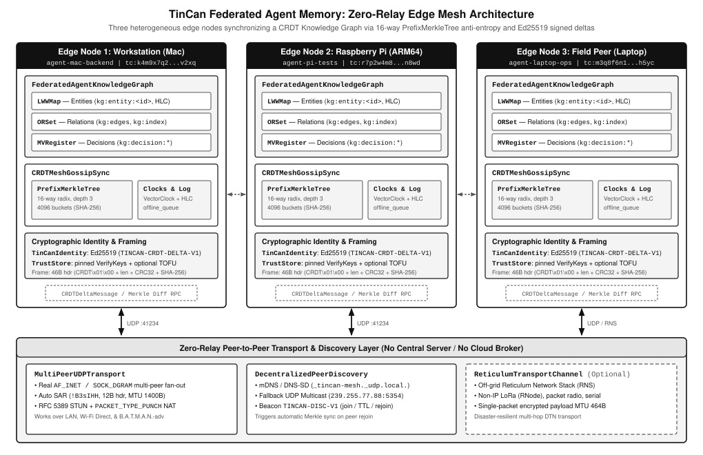
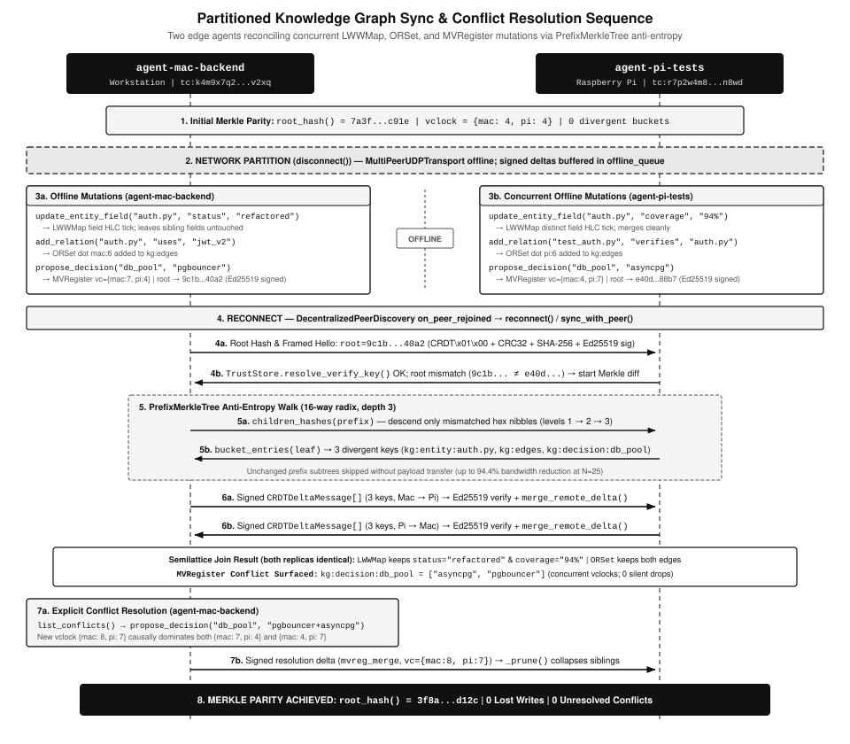
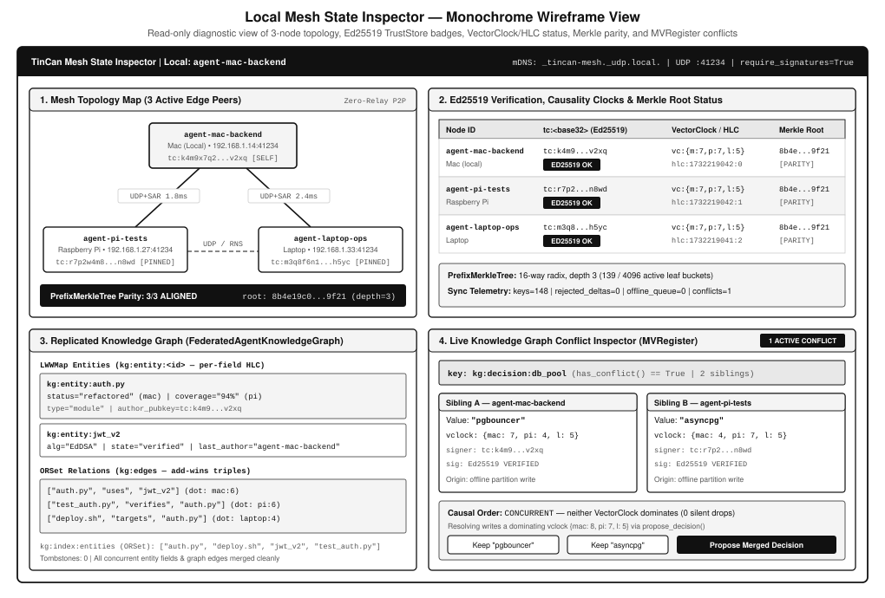
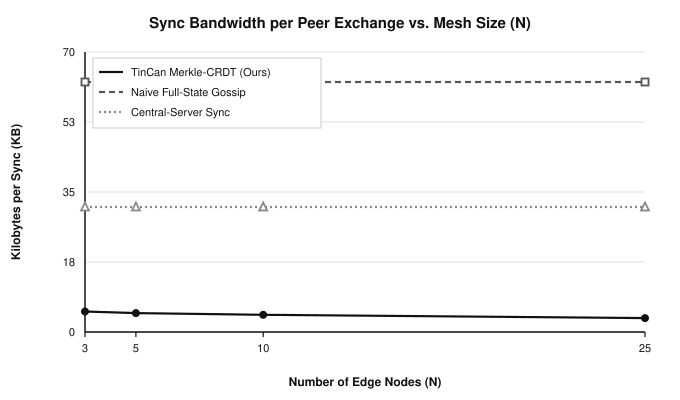
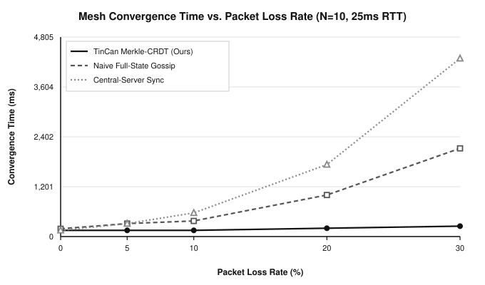

# TinCan: Cryptographically Authenticated, Conflict-Free Replicated Memory for Decentralized Edge AI Agents

**Alejandro Londono**  
Department of Electrical Engineering and Computer Science  
Florida Atlantic University, Boca Raton, FL, USA  

---

## Abstract

Autonomous large language model (LLM) agents increasingly operate across heterogeneous, intermittently connected edge hardware—workstations, laptops, Raspberry Pi single-board computers, and field gateways—where continuous cloud connectivity cannot be assumed. Existing multi-agent memory architectures rely either on centralized cloud stores that fail during wide-area network (WAN) partitions or on naive last-write-wins (LWW) full-state gossip protocols that incur prohibitive bandwidth overhead and silently discard concurrent updates. This paper presents **TinCan**, an offline-first federated agent memory system guaranteeing Strong Eventual Consistency (SEC) without central relays. TinCan models shared working memory as a `FederatedAgentKnowledgeGraph` composed of join-semilattice Conflict-Free Replicated Data Types (CRDTs): per-field Hybrid Logical Clock (HLC) `LWWMap` entities, add-wins Observed-Remove Set (`ORSet`) indices and relational triples, and Vector Clock-backed Multi-Value Registers (`MVRegister`) that preserve conflicting decisions until explicit resolution. State is indexed in an incremental 16-way `PrefixMerkleTree` ($d=3$) for Dynamo-style anti-entropy diffing, and every delta is authenticated via domain-separated Ed25519 signatures validated against a pinned `TrustStore`. A zero-relay transport layer combines multi-peer UDP with automatic Segmentation and Reassembly (SAR), RFC 5389 STUN hole-punching, dual mDNS/UDP-multicast discovery, and optional Reticulum Network Stack (RNS) radio adapters. Evaluations across $N \in \{3, 5, 10, 25\}$ nodes show a **94.43% per-sync bandwidth reduction** at $N=25$ (3,589 B vs. 64,430 B), **100% convergence** under **30% packet loss** at 25 ms RTT (250.0 ms vs. 2,125.0 ms for naive gossip and 4,290.0 ms for central-server sync), and **0 lost writes** across partitions versus **84 lost writes** in LWW/central-server baselines, surfacing all **42 concurrent conflicts**.

**Keywords:** Edge Computing, Conflict-Free Replicated Data Types (CRDTs), Merkle Anti-Entropy, Decentralized AI Agents, Federated Knowledge Graphs, Cryptographic Provenance, Delay-Tolerant Networking.

---

## 1. Introduction

Autonomous artificial intelligence (AI) agents powered by large language models (LLMs) are rapidly expanding beyond cloud-hosted sandboxes into distributed edge environments. In modern software engineering, industrial IoT, and field-response workflows, specialized agents execute concurrently across heterogeneous local devices: a backend coding agent on a developer workstation, a test-verification agent on a Raspberry Pi or low-RAM Linux gateway, and a mobile field laptop operating over intermittent wireless links. Effective collaboration across such teams requires a shared, persistent working memory capturing entities, causal relationships, and architectural or operational decisions.

Designing shared memory for decentralized edge agents exposes a core tension among local availability, bandwidth efficiency, conflict preservation, and cryptographic provenance. Centralized cloud stores—such as managed vector databases or REST state hubs—introduce a single point of failure: whenever wide-area network (WAN) connectivity severs during field outages, air-gapped operation, or disaster scenarios, physically adjacent edge peers lose synchronization capability. Routing every update through a remote cloud hub also imposes WAN round-trip latency, raises data sovereignty concerns for proprietary codebases, and creates a serialization bottleneck as agent count grows.

Replacing a central hub with naive peer-to-peer (P2P) gossip introduces two complementary failures. First, naive full-state gossip transfers the entire serialized store on every sync, scaling per-exchange traffic linearly with total state size $O(|S|)$ even when only a handful of keys diverged. Over constrained wireless or packet-radio links, shipping tens of kilobytes per peer exchange saturates bandwidth and triggers packet-loss retransmission storms. Second, naive wall-clock Last-Write-Wins (LWW) resolution—whether centralized or P2P—relies on unsynchronized physical clocks and whole-record overwrites. When partitioned agents concurrently edit distinct fields of the same software module or propose competing configuration choices, whole-record LWW silently overwrites one agent's work, corrupting collective swarm reasoning.

This paper introduces **TinCan**, a cryptographically authenticated, offline-first CRDT mesh and federated knowledge graph engineered for decentralized edge AI agents. Our primary contributions are:

1. **Semantic Conflict-Preserving Agent Memory:** A `FederatedAgentKnowledgeGraph` built from composable join-semilattice CRDTs (per-field HLC `LWWMap`, add-wins `ORSet`, and Vector Clock-backed `MVRegister`) that merges disjoint attribute updates cleanly while explicitly surfacing conflicting decisions.
2. **Prefix-Merkle Anti-Entropy:** An incremental 16-way `PrefixMerkleTree` ($d=3$, 4,096 leaf buckets) with $O(d)$ updates and Dynamo-style subtree diffing, cutting per-sync bandwidth by 94.43% at $N=25$ nodes.
3. **Zero-Trust Cryptographic Provenance:** Domain-separated Ed25519 delta signing (`TinCanIdentity`) and strict `TrustStore` verification defending against a Dolev-Yao network adversary before any clock or state mutation occurs.
4. **Disaster-Ready Zero-Relay Transport and Slim Edge Packaging:** Multi-peer UDP with automatic SAR, RFC 5389 STUN hole-punching, dual mDNS/UDP-multicast LAN discovery, optional Reticulum radio adapters, and a 118.42 KB slim edge deployment footprint.

The remainder of this paper is organized as follows. Section 2 surveys foundational literature in CRDTs, Merkle anti-entropy, logical clocks, P2P networking, federated learning, LLM agent memory, edge computing, and delay-tolerant networking. Section 3 formulates the problem and details TinCan's mathematical model, threat model, transport stack, knowledge graph schema, and edge deployment strategy. Section 4 presents our reproducible evaluation methodology, scalability, packet-loss, and partition results, and an end-to-end pair-programming case study. Section 5 concludes with key takeaways, limitations, and future work.

---

## 2. Literature Survey

TinCan synthesizes advances across distributed systems theory, cryptographic data structures, P2P networking, and autonomous agent memory.

### 2.1 CRDTs, Delta-State Replication, and Local-First Software

Under network partitions, the CAP theorem precludes simultaneous linearizability and continuous availability. Shapiro et al. [1] formalized Conflict-Free Replicated Data Types (CRDTs) to achieve **Strong Eventual Consistency (SEC)**: any two replicas delivering the same unordered set of updates deterministically converge without synchronous consensus. State-based CRDTs (CvRDTs) merge complete replica states via a monotonic join-semilattice, whereas operation-based CRDTs (CmRDTs) broadcast commutative operations over causally ordered channels. To eliminate full-state transfer overhead while tolerating packet duplication and reordering, Almeida et al. [7] introduced **Delta-State CRDTs ($\delta$-CRDTs)**, propagating compact delta-mutators that preserve semilattice idempotence. Kleppmann and Beresford [4] extended CRDT theory to nested JSON documents for local-first collaboration using multi-value registers and observed-remove sets. TinCan adapts these primitives specifically to multi-agent knowledge graphs.

### 2.2 Merkle Anti-Entropy and Logical Causality Clocks

Detecting replica divergence without transferring complete datasets relies on cryptographic hash trees introduced by Merkle [2], which enable $O(\log n)$ integrity verification and subtree comparison. Amazon's **Dynamo** [3] popularized Merkle trees for peer-to-peer anti-entropy repair across partitioned nodes by exchanging root digests and descending only mismatched subtrees. Unlike Dynamo's binary trees over data-center token ranges, TinCan uses a shallow 16-way hex-prefix radix tree (`PrefixMerkleTree`, $d=3$) over `SHA-256(key)` digests to minimize round-trips on lossy edge links.

Ordering asynchronous events without synchronized physical clocks builds on Lamport's happens-before relation [5] and Vector Clocks, which distinguish causal precedence from true concurrency ($a \parallel b$). Because vector clocks lack a physical-time tie-breaker, Kulkarni et al. [6] introduced **Hybrid Logical Clocks (HLCs)**, pairing physical wall time with bounded logical counters to guarantee causal monotonicity alongside real-time proximity. TinCan combines both: Vector Clocks govern causal dominance and conflict detection in `MVRegister`, while HLCs provide total per-field ordering in `LWWMap`.

### 2.3 P2P Networking, Federated Learning, and LLM Agent Memory

Content-addressed P2P stacks such as **IPFS** and **libp2p** [8] demonstrated self-certifying cryptographic peer identities and decentralized discovery decoupled from cloud servers, though full DHT runtimes impose nontrivial overhead on constrained edge hardware. TinCan adopts self-certifying Ed25519 identities (`tc:<base32>`) atop a minimal pure-Python UDP/multicast stack requiring no daemon or DHT bootstrap.

In distributed machine learning, **Federated Learning (FL)** [9] trains shared neural models across edge devices by exchanging gradients rather than raw data, yet standard Federated Averaging still relies on a central parameter server and operates over continuous weights rather than discrete symbolic knowledge. Conversely, LLM agent memory frameworks such as **MemGPT** [10] manage virtual context paging between prompt windows and archival stores, but target single-agent or centralized-database execution without addressing multi-agent partitions or cryptographic provenance. TinCan bridges this gap by replicating *symbolic agent memory* peer-to-peer across partitioned edge nodes.

### 2.4 Edge Computing and Delay-Tolerant Networking

Shi et al. [11] framed **Edge Computing** around proximity-driven latency reduction, WAN bandwidth savings, and privacy on resource-constrained hardware. In disaster or off-grid environments lacking IP infrastructure, the **Reticulum Network Stack (RNS)** [12] provides cryptography-native delay-tolerant routing over LoRa, packet radio, and serial links with a 464-byte encrypted packet ceiling. TinCan's abstract `MeshTransportChannel` spans both IP LANs (`MultiPeerUDPTransport`) and off-grid Reticulum radio links (`ReticulumTransportChannel`).

| Approach | Zero-Relay / Offline Writes | Conflict Preservation | Anti-Entropy Bandwidth | Cryptographic Provenance | Target Domain |
|---|---|---|---|---|---|
| Centralized Cloud Store | No (WAN-dependent) | Low (LWW / locks) | $O(|S|)$ or hub-bound | Server-mediated TLS | Cloud-connected apps |
| Naive LWW Gossip | Yes | None (silent drops) | $O(|S|)$ per sync | Optional / None | Simple state broadcast |
| Federated Learning [9] | Partial (hub-aggregated) | N/A (weight averaging) | $O(|\theta|)$ gradients | Optional | Distributed ML training |
| MemGPT [10] | Local-only | Single-agent | N/A | None | Single-agent virtual memory |
| **TinCan (Ours)** | **Yes (LAN + Off-Grid)** | **Yes (ORSet / MVReg / HLC)** | **$O(\log_{16}|S| + |\Delta|)$** | **Per-delta Ed25519 + TrustStore** | **Federated Edge AI Agents** |

*Table 1: Comparison of TinCan against related distributed state, federated intelligence, and agent memory architectures.*

---

## 3. Problem Formulation and Proposed Solution

### 3.1 System Model and Problem Formulation

Consider $N$ autonomous edge agents $\mathcal{P} = \{p_1, \dots, p_N\}$, each hosting an Ed25519 identity $I_i = (sk_i, pk_i)$ and a local knowledge-graph replica $S_i$. Nodes communicate over an asynchronous, lossy network subject to packet drops, reordering, duplication, and extended partitions $\mathcal{P} = \mathcal{P}_A \cup \mathcal{P}_B$ of duration $T_{\text{part}}$, under a Dolev-Yao adversary on the transport medium. Our protocol must satisfy four simultaneous guarantees:

1. **Strong Eventual Consistency (SEC):** Local writes commit immediately without remote coordination; once partitions heal and peers deliver the same set of authenticated deltas, replicas converge to bit-identical states ($S_i = S_j$) and identical Merkle roots ($H(S_i) = H(S_j)$).
2. **Zero Silent Write Loss:** Concurrent edits to disjoint entity fields and concurrent graph-edge additions merge without loss, while concurrent writes to mutually exclusive decisions surface explicitly as conflicts.
3. **Sub-Linear Reconciliation:** When $k \ll |S|$ keys diverge, anti-entropy metadata scales logarithmically with $|S|$ and transfers deltas only for divergent keys.
4. **Byzantine-Resistant Authentication:** Tampered, forged, or unauthorized frames are rejected prior to mutating local clocks or CRDT state.

### 3.2 Causality Clocks and Join-Semilattice CRDTs

TinCan's CRDT core (`iot_federated_agent_memory/crdt_types.py`) pairs a per-node `VectorClock` $V_i : \mathcal{P} \to \mathbb{N}$ (evaluating `before`, `after`, `equal`, or `concurrent`) with a Hybrid Logical Clock `HLC` emitting lexicographically ordered `HLCTimestamp(wall_ms, logical, node_id)` tuples [6]. Every CRDT forms a bounded join-semilattice $(S, \sqcup)$ whose merge operator $\sqcup$ is commutative, associative, and idempotent, ensuring deterministic convergence under UDP reordering, duplication, and multi-path gossip:

- **Observed-Remove Set (`ORSet`):** Implements add-wins semantics for entity indices and graph edges. State is $(A, T)$, where $A: E \to 2^{\text{Dot}}$ maps canonically serialized elements to unique causal dots `(node_id, counter)` and $T \subseteq \text{Dot}$ is a tombstone set. Removing $e$ tombstones only currently observed live dots $A[e] \setminus T$. Active elements satisfy $A[e] \setminus T \neq \emptyset$, and merge is component-wise union:
  $$(A_1, T_1) \sqcup (A_2, T_2) = \bigl(\lambda e.\, A_1[e] \cup A_2[e],\; T_1 \cup T_2\bigr).$$
  A concurrent add on a partitioned peer creates a fresh dot absent from $T$, surviving reconciliation.

- **Multi-Value Register (`MVRegister`):** Preserves concurrent conflicting decisions as a set $R = \{(v_m, V_m, p_m)\}$ tagged with authoring Vector Clocks. Merging unions entry sets and prunes causally dominated entries:
  $$R_1 \sqcup R_2 = \operatorname{prune}(R_1 \cup R_2) = \{ x \in R_1 \cup R_2 \mid \nexists y \in R_1 \cup R_2 : V_x < V_y \}.$$
  Concurrent writes ($V_A \parallel V_B$) yield $|R| > 1$ (`has_conflict() == True`) until a subsequent write with merged clock $V_{\text{res}} > V_A, V_B$ resolves the conflict back to a single value.

- **Per-Field HLC Last-Write-Wins Map (`LWWMap`):** Stores entity attributes as $M: F \to (\text{val}, t_{\text{hlc}}, \text{deleted})$ with independent HLC timestamps and tombstone flags per field:
  $$(M_1 \sqcup M_2)[f] = \arg\max_{x \in \{M_1[f], M_2[f]\}} x.t_{\text{hlc}}.$$
  Concurrent edits to disjoint fields of the same entity therefore merge cleanly without clobbering sibling attributes.

### 3.3 Prefix-Bucketed Merkle Anti-Entropy (`PrefixMerkleTree`)

Each `CRDTMeshGossipSync` node indexes its keys in an incremental 16-way radix Merkle tree (`merkle_tree.py`) of depth $d \in [1, 6]$ (default $d=3$, yielding $16^3 = 4,096$ leaf buckets). Key $k$ maps to leaf bucket $\text{SHA-256}(k)[:d]$ storing the deterministic `state_hash()` of its CRDT. Local writes and remote merges recompute only the affected leaf and $d$ ancestors in $O(d)$ time.

During peer synchronization (`sync_with_peer`), replicas execute a Dynamo-style top-down walk (`diff_with`): (1) **Root Parity Check** exchanges 64-byte root hashes and short-circuits immediately on equality; (2) **Prefix Descent** exchanges sparse non-empty child hash maps (up to 16 nibbles) only along mismatched prefixes; and (3) **Selective Delta Transfer** compares `(key -> state_hash)` entries only inside divergent leaf buckets to isolate exact divergent keys $K_\Delta$, transmitting only unseen `CRDTDeltaMessage` frames absent from the peer's `seen_delta_hashes`.

### 3.4 Cryptographic Identity, Signed Deltas, and Threat Model

TinCan assumes a **Dolev-Yao network adversary** on untrusted LAN or wireless links capable of eavesdropping, modifying, truncating, replaying, spoofing, or injecting frames (`docs/threat_model.md`). Device physical compromise, Layer-1 RF jamming, and broadcast link confidentiality (handled orthogonally via X25519 `SealedBox` or Reticulum link encryption) are out of scope.

Each node holds an Ed25519 keypair (`TinCanIdentity`, PyNaCl/libsodium) identified by `tc:<base32(verify_key)>`. Every `CRDTDeltaMessage` is canonically serialized (`sort_keys=True, separators=(",", ":")`, excluding `signature`), prefixed with domain separator `b"TINCAN-CRDT-DELTA-V1\x00"`, signed with Ed25519, and framed with a 46-byte binary header (`FRAME_MAGIC = b"CRDT\x01\x00"`, payload length, CRC32, and SHA-256). On receipt, `merge_remote_delta` enforces four ordered checks before mutating any clock or CRDT: (1) framing, CRC32, and SHA-256 (`FrameIntegrityError`); (2) presence of `sender_pubkey` and `signature`; (3) `TrustStore.resolve_verify_key(node_id, sender_pubkey)` enforcing explicit key pinning (`trust_on_first_use=False`) or opt-in TOFU; and (4) Ed25519 `VerifyKey.verify()`. Failures raise `DeltaAuthenticationError` and leave all local state untouched (Table 2).

| Attack Vector | Adversary Mechanism | TinCan Mitigation |
|---|---|---|
| **In-transit tampering** | Edit `value`, `key`, `vclock`, or `operation` and recompute CRC32 + SHA-256 | Domain-separated Ed25519 signature covers all canonical fields; fails with `DeltaAuthenticationError`. |
| **Sender spoofing / forgery** | Fabricate delta with victim's `node_id` signed by attacker key | `TrustStore` binds `node_id` to pinned `VerifyKey`; mismatched key is rejected. |
| **Replay attack** | Re-transmit previously observed valid signed delta | `seen_delta_hashes` deduplication + CRDT semilattice idempotence (strict no-op). |
| **Unauthorized peer injection** | Rogue node broadcasts self-signed deltas | Strict `TrustStore` (`trust_on_first_use=False`) rejects unpinned keys. |
| **Clock manipulation** | Rogue node sends inflated HLC/VectorClock counters | Rejected before `VectorClock.merge()` or `HLC.receive()` executes. |

*Table 2: Dolev-Yao threat model attack matrix and mitigations in TinCan's CRDT mesh.*

### 3.5 Disaster-Ready Zero-Relay Transport and Discovery Stack

TinCan decouples CRDT state from networking via `MeshTransportChannel` (`p2p_transport.py`, `mdns_discovery.py`, `crdt_mesh.py`):

- **`MultiPeerUDPTransport`:** Non-blocking `AF_INET`/`SOCK_DGRAM` multi-peer fan-out over LAN, Wi-Fi Direct, or B.A.T.M.A.N.-adv (1,400 B default MTU). Payloads exceeding MTU trigger automatic Segmentation and Reassembly (SAR) via a 12-byte header (`!B3sIHH`: type `0x02`, magic `b"SAR"`, `msg_id`, `idx`, `total`) with 15 s stale-buffer expiry. For cross-NAT peering without relays, the same UDP socket supports RFC 5389 STUN endpoint discovery (`stun.l.google.com:19302`, `stun.cloudflare.com:3478`) and `PACKET_TYPE_PUNCH` (`0x03`) NAT hole-punching datagrams.
- **`DecentralizedPeerDiscovery`:** Dual-backend LAN discovery supporting (1) mDNS/DNS-SD (`_tincan-mesh._udp.local.` via `zeroconf`) and (2) a zero-dependency UDP multicast beacon (`239.255.77.88:5354`, `TINCAN-DISC-V1`, 1.0 s interval, 4.0 s TTL) with automatic join, loss, and rejoin callbacks.
- **Off-Grid Radio Adapters:** `ReticulumTransportChannel` adapts the Reticulum Network Stack [12] (464 B single-packet ceiling), while `BLELoRaFrameBufferChannel` provides 8-byte SAR over BLE (240 B) and LoRa (222 B) frame buffers.

### 3.6 Federated Agent Knowledge Graph Schema

`FederatedAgentKnowledgeGraph` (`agent_kg_crdt.py`) organizes multi-agent memory into four keyspaces: (1) **Entities** (`kg:entity:<id>`, `LWWMap` storing attributes and Ed25519 `author_pubkey`), (2) **Entity Index** (`kg:index:entities`, `ORSet`), (3) **Relations** (`kg:edges`, `ORSet` of `[src, predicate, dst]` triples), and (4) **Decisions** (`kg:decision:<topic>`, `MVRegister`), exposing `context_snapshot()` for deterministic LLM prompt injection. Figures 1–3 depict the architecture, partitioned sync sequence, and local mesh state inspector.

  
*Figure 1: Three-node edge mesh architecture showing `FederatedAgentKnowledgeGraph`, depth-3 `PrefixMerkleTree`, Ed25519 `TinCanIdentity` + `TrustStore`, and zero-relay P2P transport/discovery.*

  
*Figure 2: Synchronization sequence between `agent-mac-backend` and `agent-pi-tests` across a network partition, including Ed25519 verification, Merkle diffing, conflict surfacing, and resolution.*

  
*Figure 3: Monochrome wireframe of the local mesh state inspector showing 3-node topology, `tc:<base32>` trust badges, VectorClock/HLC status, Merkle parity, and live `MVRegister` conflicts.*

### 3.7 Edge Deployment Strategy

For constrained single-board computers (Raspberry Pi / low-RAM Linux), TinCan isolates its 8 core CRDT/P2P modules (`crdt_types.py`, `merkle_tree.py`, `tincan_core.py`, `crdt_mesh.py`, `p2p_transport.py`, `mdns_discovery.py`, `agent_kg_crdt.py`, and `local_p2p_mesh.py`) inside a minimal `python:3.11-slim` container (`Dockerfile.edge`) installing only `PyNaCl` and optional `zeroconf`. Direct footprint measurement (`scripts/measure_edge_footprint.py`, `edge_footprint.json`) running two Ed25519-enforced UDP nodes over a 200-key workload (190 entities, 69 relations, 8 decisions, 3 concurrent conflicts) records a slim code footprint of **118.42 KB** (a **96.88%** reduction vs. 3,793.17 KB for the full package), peak RSS memory of **51.47 MB** (+19.16 MB delta above baseline Python), **1,055.86 ms** CPU time, and **128 B** post-reconnect Merkle parity verification. Nodes follow a three-tier rollout—zero-config LAN join via mDNS/multicast, STUN/UDP internet peering, and optional Reticulum radio fallback—with rolling container updates requiring zero cluster downtime.

---

## 4. Evaluation Methodology, Results, and Discussion

### 4.1 Experimental Setup and Baselines

We evaluate TinCan using a deterministic benchmark harness (`scripts/eval_mesh_benchmarks.py`, seed `42`) executing the real `CRDTMeshGossipSync`, `PrefixMerkleTree` ($d=3$), Ed25519 `TinCanIdentity` + strict `TrustStore`, and `FederatedAgentKnowledgeGraph` modules. We compare `tincan_merkle_crdt` against two baselines: (1) **Naive Full-State Gossip (`naive_full_state_gossip`)**, transmitting the full serialized store per peer exchange with whole-record wall-clock LWW overwrites; and (2) **Central-Server Sync (`central_server_sync`)**, a star topology routing through a central hub over $3\times$ WAN latency with hub queuing overhead and LWW overwrites.

### 4.2 Experiment 1: Mesh Scalability ($N \in \{3, 5, 10, 25\}$)

Clusters of $N \in \{3, 5, 10, 25\}$ nodes are seeded with 200 baseline keys (~32 KB serialized state). Following a partition, 9 keys diverge: 8 entity field updates via `LWWMap` plus 1 concurrent `MVRegister` decision (`"merkle-gossip"` vs. `"eager-push"`) on `kg:decision:sync_policy`. Nodes run $\lceil \log_2 N \rceil + 1$ gossip rounds over a 20 ms link until full Merkle parity. Table 3 reports exact results from `exp1_scalability.csv`, and Figure 4 plots per-sync bandwidth.

| Protocol | Nodes ($N$) | Rounds | Conv. Time (ms) | Bytes / Sync | Total Mesh Bytes | Conflicts | Lost Writes |
|---|---:|---:|---:|---:|---:|---:|---:|
| **TinCan Merkle-CRDT** | **3** | 3 | 120.00 | **5,289** | 47,607 | **1** | **0** |
| Naive Full-State Gossip | 3 | 3 | 1,666.32 | 64,430 | 579,870 | 0 | 1 |
| Central-Server Sync | 3 | 2 | 134.78 | 32,215 | 193,290 | 0 | 1 |
| **TinCan Merkle-CRDT** | **5** | 4 | 160.00 | **4,868** | 97,371 | **1** | **0** |
| Naive Full-State Gossip | 5 | 4 | 2,221.76 | 64,430 | 1,288,600 | 0 | 1 |
| Central-Server Sync | 5 | 2 | 142.55 | 32,215 | 322,150 | 0 | 1 |
| **TinCan Merkle-CRDT** | **10** | 5 | 200.00 | **4,442** | 222,120 | **1** | **0** |
| Naive Full-State Gossip | 10 | 5 | 2,777.20 | 64,430 | 3,221,500 | 0 | 1 |
| Central-Server Sync | 10 | 2 | 165.55 | 32,215 | 644,300 | 0 | 1 |
| **TinCan Merkle-CRDT** | **25** | 6 | 240.00 | **3,589** | 538,453 | **1** | **0** |
| Naive Full-State Gossip | 25 | 6 | 3,332.64 | 64,430 | 9,664,500 | 0 | 1 |
| Central-Server Sync | 25 | 2 | 232.95 | 32,215 | 1,610,750 | 0 | 1 |

*Table 3: Experiment 1 scalability results across $N \in \{3, 5, 10, 25\}$ (200 keys, 9 divergent, 20 ms latency, seed 42).*

  
*Figure 4: Synchronization bandwidth per peer exchange (KB) versus mesh size $N \in \{3, 5, 10, 25\}$.*

At $N=25$, TinCan achieves a **94.43% per-sync bandwidth reduction** versus naive full-state gossip (3,589 B vs. 64,430 B) and an 88.86% reduction versus central-server sync (32,215 B), cutting total mesh traffic by $17.95\times$ relative to naive gossip (538,453 B vs. 9,664,500 B) and 66.57% relative to central sync (1,610,750 B). Notably, TinCan's mean bytes per sync *decrease* as $N$ grows (5,289 B at $N=3$ down to 3,589 B at $N=25$) because later rounds increasingly encounter already-converged peers that short-circuit at the 64-byte root hash check. Convergence latency at $N=25$ is 240.00 ms—$13.89\times$ faster than naive gossip (3,332.64 ms) and comparable to central-server sync (232.95 ms) without central infrastructure or silent write loss.

### 4.3 Experiment 2: Packet Loss Resilience (0%–30% Loss at 25 ms RTT)

Experiment 2 sweeps UDP packet loss across $\{0\%, 5\%, 10\%, 20\%, 30\%\}$ at 25 ms RTT for $N=10$ nodes (150 baseline keys, 10 concurrent per-node writes). Table 4 summarizes `exp2_packet_loss.csv`, and Figure 5 plots convergence time.

| Loss (%) | TinCan Rounds | TinCan Time (ms) | TinCan Bytes | Naive Rounds | Naive Time (ms) | Naive Bytes | Central Rounds | Central Time (ms) | Central Bytes |
|---:|---:|---:|---:|---:|---:|---:|---:|---:|---:|
| **0%** | 3 | **150.0** | **216,617** | 3 | 187.5 | 708,330 | 2 | 150.00 | 472,220 |
| **5%** | 3 | **150.0** | **214,352** | 5 | 312.5 | 1,180,550 | 3 | 312.19 | 495,831 |
| **10%** | 3 | **150.0** | **222,641** | 6 | 375.0 | 1,416,660 | 4 | 570.00 | 519,442 |
| **20%** | 4 | **200.0** | **226,277** | 16 | 1,000.0 | 3,777,760 | 7 | 1,732.50 | 566,664 |
| **30%** | 5 | **250.0** | **229,774** | 34 | 2,125.0 | 8,027,740 | 11 | 4,290.00 | 613,886 |

*Table 4: Experiment 2 packet-loss sweep ($N=10$, 150 keys, 25 ms RTT, seed 42; 100% convergence across all runs).*

  
*Figure 5: Mesh convergence time (ms) across 0%–30% packet loss at 25 ms RTT ($N=10$).*

TinCan remains highly stable under loss: 0%–10% loss holds steady at 3 rounds (150.0 ms), rising to 4 rounds (200.0 ms) at 20% loss and 5 rounds (250.0 ms) at 30% loss, with total bytes growing only 6.07% (216,617 B to 229,774 B). At 30% loss, naive gossip degrades to 34 rounds, 2,125.0 ms ($8.50\times$ slower), and 8,027,740 bytes ($34.94\times$ more traffic) due to multi-packet full-state vulnerability $(1-p)^k$, while central-server sync escalates to 4,290.0 ms ($17.16\times$ slower) under WAN retransmission backoff.

### 4.4 Experiment 3: Partition Duration and Conflict Preservation

Experiment 3 partitions $N=5$ `FederatedAgentKnowledgeGraph` agents into Group A (agents 0–1) and Group B (agents 2–4) across $\{2, 5, 10, 25\}$ concurrent operations per side (simulated 30 s, 75 s, 150 s, and 375 s partitions). Each iteration concurrently edits disjoint `file:core.py` attributes, adds distinct `ORSet` edges, and proposes competing `MVRegister` decisions on `policy_i`. Table 5 and Figure 6 report exact values from `exp3_partition_conflicts.csv`.

| Ops / Side (Duration) | Protocol | Conflicts Detected | Lost Writes | Recovery Bytes | Local Sync Available |
|---|---|---:|---:|---:|:---:|
| **2 ops (30 s)** | **TinCan Merkle-CRDT** | **2** | **0** | 58,534 | **Yes** |
| 2 ops (30 s) | Naive / Central Baselines | 0 / 0 | 4 / 4 | 4,376 / 4,376 | Yes / No |
| **5 ops (75 s)** | **TinCan Merkle-CRDT** | **5** | **0** | 152,759 | **Yes** |
| 5 ops (75 s) | Naive / Central Baselines | 0 / 0 | 10 / 10 | 8,744 / 8,744 | Yes / No |
| **10 ops (150 s)** | **TinCan Merkle-CRDT** | **10** | **0** | 354,475 | **Yes** |
| 10 ops (150 s) | Naive / Central Baselines | 0 / 0 | 20 / 20 | 16,024 / 16,024 | Yes / No |
| **25 ops (375 s)** | **TinCan Merkle-CRDT** | **25** | **0** | 1,292,891 | **Yes** |
| 25 ops (375 s) | Naive / Central Baselines | 0 / 0 | 50 / 50 | 38,944 / 38,944 | Yes / No |

*Table 5: Experiment 3 network partition recovery ($N=5$ agents across 2–25 concurrent operations per side).*

  
*Figure 6: Silently lost writes during network partitions versus concurrent writes per partitioned side ($N=5$).*

Cumulatively across all four regimes, TinCan incurs **0 lost writes** while detecting all **42 concurrent decision conflicts** ($2+5+10+25$), whereas both LWW and central-server baselines silently drop **84 writes** ($4+10+20+50$) with zero conflict visibility, and central-server sync loses intra-partition availability (`local_sync_available_during_partition = False`). Table 5 also highlights a transparent tradeoff: under heavy repeated mutations to the same keys (25 ops/side), TinCan transfers 1,292,891 recovery bytes versus 38,944 B for baselines because `_deltas_by_key` currently replays every individual signed delta rather than compacting sequential per-key mutations into a single signed state-delta prior to sync.

### 4.5 End-to-End Pair-Programming Partition Case Study

Running `scripts/demo_pair_programming_mesh.py` validates TinCan over live OS UDP sockets (`MultiPeerUDPTransport`) between `agent-mac-backend` and `agent-pi-tests` with mutually pinned Ed25519 `TrustStore` instances. Starting from Merkle parity on `task:auth-refresh` and `file:auth.py`, both agents disconnect and mutate state offline: `agent-mac-backend` sets `patch_status = "refresh_lock_added"`, adds `file:token_store.py` and edge `file:auth.py --calls--> file:token_store.py`, and proposes `jwt_ttl_minutes = 15`; concurrently, `agent-pi-tests` sets `test_status = "regression_test_added"`, adds `file:test_auth.py` and edge `file:test_auth.py --verifies--> file:auth.py`, and proposes `jwt_ttl_minutes = 60`. Upon reconnection, both disjoint fields and all 3 edges merge cleanly, `list_conflicts()` surfaces `{"topic": "jwt_ttl_minutes", "values": [15, 60]}`, and a subsequent resolution to `30` propagates over UDP to restore identical Merkle roots across both nodes in 38,841 total UDP bytes with zero lost writes.

---

## 5. Summary and Conclusions

This paper presented **TinCan**, an offline-first, cryptographically authenticated CRDT mesh and federated knowledge graph for decentralized edge AI agents. Combining join-semilattice CRDTs (`ORSet`, `MVRegister`, and per-field HLC `LWWMap`), an incremental 16-way `PrefixMerkleTree` ($d=3$), domain-separated Ed25519 delta authentication with strict `TrustStore` pinning, and a zero-relay UDP/SAR/STUN/mDNS/Reticulum transport stack packaged into a 118.42 KB slim edge footprint, TinCan resolves the availability, bandwidth, and conflict-loss limitations of centralized stores and naive LWW gossip.

Empirically, TinCan reduces per-sync bandwidth by **94.43%** at $N=25$ (3,589 B vs. 64,430 B), achieves **100% convergence in 250.0 ms under 30% packet loss** at 25 ms RTT ($8.50\times$ faster than naive gossip and $17.16\times$ faster than central-server sync), and guarantees **0 lost writes** across partitions versus **84 lost writes** on baselines while surfacing all **42 concurrent conflicts**.

**Limitations and Future Work:** Three directions guide future work. First, implementing causal per-key delta-log compaction and `ORSet` tombstone garbage collection via observed causal stability will eliminate the heavy-partition recovery-byte overhead noted in Experiment 3. Second, adding optional peer-assisted TURN-style relay fallback will complement STUN hole-punching across symmetric carrier-grade NATs. Third, we plan physical field trials over Reticulum Network Stack LoRa (RNode) hardware, integration of scalable multi-hop epidemic gossip (HyParView/Plumtree) for meshes exceeding $N > 100$ nodes, and optional X25519 payload encryption over open RF broadcast links.

---

## References

[1] M. Shapiro, N. Preguiça, C. Baquero, and M. Zawirski, "Conflict-Free Replicated Data Types," in *Proc. SSS 2011*, LNCS vol. 6976, pp. 386–400, Springer, 2011.

[2] R. C. Merkle, "A Digital Signature Based on a Conventional Encryption Function," in *Advances in Cryptology — CRYPTO '87*, LNCS vol. 293, pp. 369–378, Springer, 1987.

[3] G. DeCandia, D. Hastorun, M. Jampani, G. Kakulapati, A. Lakshman, A. Pilchin, S. Sivasubramanian, P. Vosshall, and W. Vogels, "Dynamo: Amazon's Highly Available Key-value Store," in *Proc. 21st ACM SOSP*, pp. 205–220, 2007.

[4] M. Kleppmann and A. R. Beresford, "A Conflict-Free Replicated JSON Datatype," *IEEE Trans. Parallel Distrib. Syst.*, vol. 28, no. 10, pp. 2733–2746, Oct. 2017.

[5] L. Lamport, "Time, Clocks, and the Ordering of Events in a Distributed System," *Commun. ACM*, vol. 21, no. 7, pp. 558–565, July 1978.

[6] S. S. Kulkarni, M. Demirbas, D. Madappa, B. Avva, and M. Leone, "Logical Physical Clocks and Consistent Snapshots in Globally Distributed Databases," in *Proc. OPODIS 2014*, LNCS vol. 8878, pp. 17–32, Springer, 2014.

[7] P. S. Almeida, A. Shoker, and C. Baquero, "Delta State Replicated Data Types," *J. Parallel Distrib. Comput.*, vol. 111, pp. 162–173, Jan. 2018.

[8] J. Benet, "IPFS - Content Addressed, Versioned, P2P File System," *arXiv:1407.3561*, 2014.

[9] B. McMahan, E. Moore, D. Ramage, S. Hampson, and B. A. y Arcas, "Communication-Efficient Learning of Deep Networks from Decentralized Data," in *Proc. AISTATS 2017*, PMLR vol. 54, pp. 1273–1282, 2017.

[10] C. Packer, S. Wooders, K. Lin, V. Fang, S. G. Patil, I. Stoica, and J. E. Gonzalez, "MemGPT: Towards LLMs as Operating Systems," *arXiv:2310.08560*, 2023.

[11] W. Shi, J. Cao, Q. Zhang, Y. Li, and L. Xu, "Edge Computing: Vision and Challenges," *IEEE Internet of Things J.*, vol. 3, no. 5, pp. 637–646, Oct. 2016.

[12] M. Qvist, "Reticulum Network Stack: Cryptography-Based Networking Stack for Building Unstoppable Networks with LoRa, Packet Radio, WiFi and Everything in Between," *Reticulum Technical Specification*, 2022. https://reticulum.network/
