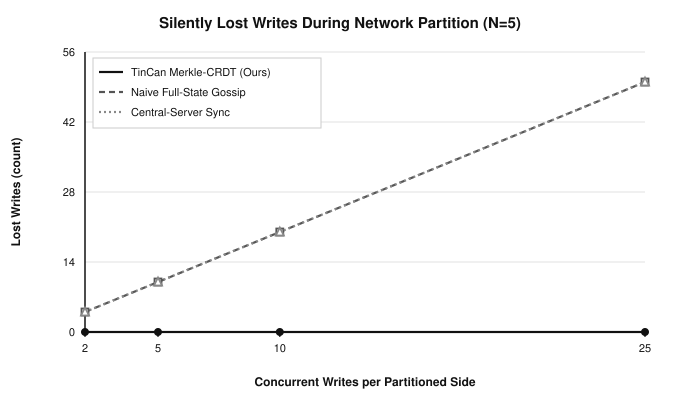

# TinCan: Authenticated, Conflict-Free Shared Memory for Decentralized Edge AI Agents

**Alejandro Londono**  
Department of Electrical Engineering and Computer Science  
Florida Atlantic University, Boca Raton, FL, USA  

---

## Abstract

AI coding assistants and autonomous agents increasingly run on local devices—laptops, desktops, Raspberry Pi boards, and field gateways—rather than solely in remote cloud datacenters. When multiple agents collaborate across different machines, they need a shared working memory recording files, tasks, relationships, and design decisions. Today, centralized cloud stores break local sync whenever internet access drops, while naive peer-to-peer (P2P) gossip wastes bandwidth by broadcasting full state and silently overwrites concurrent offline edits.

This paper presents **TinCan**, an offline-first shared memory system for decentralized edge AI agents with no central server or cloud relay. TinCan stores agent memory as a **knowledge graph** built from **Conflict-Free Replicated Data Types (CRDTs)** that automatically merge concurrent edits into identical final state: per-field maps (`LWWMap`) for entity attributes, add-wins sets (`ORSet`) for graph edges, and multi-value registers (`MVRegister`) that flag conflicting decisions instead of dropping them. A 16-way **Prefix Merkle Tree** pinpoints only changed keys during sync, and every update is signed with **Ed25519** and verified against a pinned `TrustStore`.

We evaluate TinCan's Python implementation using a reproducible hybrid simulation harness (seed 42) across $N \in \{3, 5, 10, 25\}$ nodes, a live loopback UDP pair-programming demo, and macOS profiling of the slim 8-module edge build. Against modeled naive full-state gossip and central-server baselines, TinCan cuts per-sync bandwidth by **94.43%** at $N=25$ (3,589 B vs. 64,430 B), converges under **30% simulated packet loss** (250.0 ms vs. 2,125.0 ms and 4,290.0 ms), and loses **0 writes** across partitions (vs. **84 lost writes** in baselines) while surfacing all **42 concurrent conflicts**. We also clearly separate locally executed tests from physical multi-machine, Raspberry Pi, and radio trials planned next.

**Keywords:** Edge Computing, Conflict-Free Replicated Data Types (CRDTs), Merkle Anti-Entropy, Decentralized AI Agents, Federated Knowledge Graphs, Cryptographic Provenance, Offline-First Networking.

---

## 1. Introduction

In *The Third Industrial Revolution* and the accompanying VICE documentary *The Third Industrial Revolution: A Radical New Sharing Economy* [13], economic theorist Jeremy Rifkin argues that modern infrastructure is undergoing a historic architectural shift: *"The revolution here is from hierarchical to lateral power. That's the power shift."* As communication, energy, and edge computing converge into an Internet of Things (IoT), Rifkin describes the result as *"a distributed nervous system that will allow everyone on the planet at low cost to engage directly with each other"*—a platform *"designed to be distributed, not centralised"* that *"works best when it is collaborative, open and transparent, rather than closed and proprietary"* [13].

Software development and edge automation reflect this same transition: instead of a single AI assistant inside a cloud browser, teams of specialized AI agents now run locally across user devices—for example, a backend coding agent on a developer's laptop collaborating with a testing agent on a second workstation or Raspberry Pi. Yet ironically, most multi-agent tools still route shared memory through a centralized, hierarchical cloud server, contradicting the lateral peer-to-peer model that makes edge IoT resilient.

Building true lateral shared memory for edge agents is hard because four practical goals pull against each other:

1. **Offline availability:** Edge devices frequently lose internet access—on airplanes, in basements, during storms, or on air-gapped networks. If shared memory lives only on a central cloud server, a wide-area network (WAN) outage immediately stops local agents from syncing with each other even when they are on the same Wi-Fi network.
2. **Low bandwidth:** Edge links—such as Wi-Fi, cellular hotspots, or off-grid radios—have limited bandwidth and frequent packet drops. Sending the entire memory database back and forth on every sync wastes airtime and slows down recovery after a disconnect.
3. **No silent data loss:** When two agents work independently during a disconnect and later reconnect, simple "last-write-wins" (LWW) rules pick whichever record has a newer clock timestamp and quietly throw away the other agent's changes. If Agent A updates a file's patch status while Agent B updates that same file's test status, whole-record LWW destroys one of those updates without warning.
4. **Trust without a central server:** Without a central server checking logins, any compromised device on a local network could forge fake updates, tamper with messages in transit, or poison an agent's memory.

This paper introduces **TinCan**, a decentralized, offline-first shared memory system designed specifically for edge AI agents. Rather than relying on a central relay or naive full-state broadcasting, TinCan combines four proven building blocks into a compact, pure-Python architecture:

- **Conflict-preserving agent memory (`FederatedAgentKnowledgeGraph`):** Instead of storing generic blobs, TinCan models entities (files, tasks, bugs), relations (call graphs, test links), and architectural decisions using three complementary CRDTs—per-field `LWWMap`, add-wins `ORSet`, and conflict-detecting `MVRegister`—so concurrent work merges cleanly and real disagreements are surfaced to the user or agent.
- **Fast, selective sync (`PrefixMerkleTree`):** Each node maintains a shallow 16-way cryptographic hash tree over its keys. When two peers reconnect, they compare root hashes and walk down only the branches that differ, sending deltas only for changed keys rather than the whole database.
- **Per-message cryptographic verification (`TinCanIdentity` and `TrustStore`):** Every node owns an Ed25519 signing keypair. Every delta is signed before transmission and verified against a list of trusted peer keys before it can touch local clocks or memory.
- **Zero-relay transport and slim edge packaging:** TinCan separates its memory layer from networking through a pluggable transport interface supporting multi-peer UDP with automatic packet splitting/reassembly (SAR), STUN NAT hole-punching for internet peering, dual mDNS/UDP-multicast local discovery, and an optional adapter for the off-grid Reticulum Network Stack. The core runtime fits in **118.42 KB** of Python code packaged into a minimal `Dockerfile.edge` container.

The rest of this paper is organized as follows. Section 2 reviews related work in CRDTs, Merkle trees, logical clocks, peer-to-peer networking, federated learning, LLM agent memory, and edge/delay-tolerant networking. Section 3 explains the problem setup and TinCan's design in plain, verifiable detail—including its consistency rules, Merkle sync protocol, security threat model, transport stack, knowledge graph schema, and edge deployment packaging. Section 4 presents our evaluation methodology and results across scalability, packet loss, network partitions, and a live loopback UDP pair-programming demo, clearly distinguishing executed code from simulated network baselines. Section 5 summarizes our conclusions, candidly documents current experimental limitations, and outlines next steps for physical hardware field testing.

---

## 2. Literature Survey

TinCan builds on established ideas from distributed databases, peer-to-peer networking, and AI agent systems, adapting them to the specific needs of decentralized edge coding agents.

### 2.1 Conflict-Free Replicated Data Types (CRDTs)

Under network partitions, the CAP theorem shows that a system cannot simultaneously maintain strict linearizability and accept local writes on both sides of a split. **Shapiro et al. [1]** formalized **Conflict-Free Replicated Data Types (CRDTs)** to guarantee **Strong Eventual Consistency (SEC)**: any two devices delivering the same set of updates—regardless of order or duplicates—deterministically converge without a central lock server. Because edge wireless links drop and duplicate packets, **Almeida et al. [7]** introduced **Delta-State CRDTs ($\delta$-CRDTs)**, shipping compact partial updates ("deltas") that still merge idempotently. **Kleppmann and Beresford [4]** extended CRDTs to nested JSON documents using Observed-Remove Sets and Multi-Value Registers. TinCan applies these primitives to a structured AI agent knowledge graph.

### 2.2 Merkle Trees and Logical Clocks

When peers reconnect after long disconnects, they need a fast way to locate missing updates. **Merkle [2]** introduced cryptographic hash trees where a single root hash summarizes an entire dataset, and Amazon's **Dynamo [3]** used Merkle trees for P2P anti-entropy repair by descending only mismatched subtrees. TinCan adapts this with a shallow 16-way prefix tree (`PrefixMerkleTree`, depth 3) to isolate divergent keys in at most four round-trips.

Because offline device clocks drift, distributed systems cannot trust raw wall clocks alone. **Lamport [5]** defined logical *happens-before* clocks, later extended to **Vector Clocks** (one counter per node) that distinguish causal order from true concurrency ($A \parallel B$). **Kulkarni et al. [6]** introduced **Hybrid Logical Clocks (HLCs)**, pairing physical wall time with a small logical counter for causal monotonicity plus deterministic tie-breaking. TinCan uses Vector Clocks in `MVRegister` to surface conflicts and HLCs in `LWWMap` for per-field ordering.

### 2.3 Peer-to-Peer Systems, Federated Learning, and Agent Memory

**IPFS and libp2p [8]** demonstrated self-certifying cryptographic peer IDs and decentralized discovery, though full DHT daemons add overhead on small edge teams; TinCan keeps self-certifying Ed25519 IDs (`tc:<base32>`) atop a minimal Python UDP/multicast layer. **Federated Learning [9]** trains neural weights across edge devices without uploading raw data, but typically relies on a central parameter server and continuous tensors rather than symbolic facts. **MemGPT [10]** adds virtual context paging for LLMs, but targets single-agent or centralized setups. TinCan bridges this gap by replicating symbolic agent memory peer-to-peer.

### 2.4 Edge Computing and Off-Grid Networking

**Shi et al. [11]** framed **Edge Computing** around low-latency local processing, WAN bandwidth savings, and privacy. For disaster or air-gapped links lacking IP infrastructure, the **Reticulum Network Stack (RNS) [12]** provides pure-Python encrypted routing over LoRa, serial, packet radio, and Wi-Fi. TinCan runs over standard UDP today while exposing an adapter interface for Reticulum radio links.

| Architecture | Works Offline (No Cloud) | Prevents Silent Write Loss | Sync Bandwidth | Message Authentication | Primary Use Case |
|---|---|---|---|---|---|
| Centralized Cloud Store | No (stops when WAN drops) | Weak (whole-record LWW / locks) | Full or hub-bound | Server-mediated TLS | Cloud-connected web apps |
| Naive Full-State Gossip | Yes | No (silent LWW overwrites) | $O(|S|)$ every sync | Often none | Simple small-scale broadcast |
| Federated Learning [9] | Partial (needs hub aggregator) | N/A (averages model weights) | $O(|\theta|)$ gradients | Optional | Distributed ML training |
| MemGPT [10] | Local single machine | Single-agent only | N/A | None | Single-agent context paging |
| **TinCan (Ours)** | **Yes (LAN + STUN + Off-Grid adapter)** | **Yes (`ORSet`, `MVRegister`, HLC `LWWMap`)** | **$O(\log_{16}|S| + |\Delta|)$** | **Per-delta Ed25519 + `TrustStore`** | **Multi-agent edge memory** |

*Table 1: High-level comparison of TinCan against related distributed storage, federated learning, and agent memory approaches.*

---

## 3. Problem Formulation and Proposed Solution

### 3.1 What We Are Solving

Suppose a team of $N$ edge AI agents $\mathcal{P} = \{p_1, \dots, p_N\}$ runs on separate machines. Each agent $p_i$ has its own Ed25519 cryptographic identity $(sk_i, pk_i)$ and keeps a full local copy $S_i$ of the team's shared knowledge graph. The network connecting them is unreliable: packets can be dropped, duplicated, or arrive out of order, and the group can split into disconnected partitions $\mathcal{P}_A$ and $\mathcal{P}_B$ for minutes or hours. In addition, an attacker on the shared Wi-Fi or local network may attempt to inspect, alter, replay, or forge sync packets.

TinCan is engineered to guarantee four practical properties under these conditions:

1. **Always-available local writes with automatic convergence (SEC):** Any agent can read and write its local memory immediately, even with zero network connectivity. Once connectivity returns and peers exchange their authenticated deltas, every node converges to the exact same state ($S_i = S_j$) and the exact same Merkle root hash.
2. **Zero silent data loss:** If two offline agents edit different fields of the same entity (for example, `patch_status` and `test_status` on `auth.py`) or add different relationships, *both* edits survive the merge. If they make genuinely conflicting choices on the same decision (for example, setting a token timeout to 15 minutes vs. 60 minutes), both choices are preserved and flagged so an agent or human can resolve them explicitly.
3. **Low-bandwidth catch-up:** When only a few keys changed out of hundreds, peers should not re-send the entire memory store—they should locate and transfer only the changed keys.
4. **Strict cryptographic verification:** Any tampered, forged, or unauthorized packet must be rejected *before* it can update a node's logical clocks or memory.

### 3.2 Clocks and Conflict-Free Data Structures

TinCan implements its clocks and CRDTs in `iot_federated_agent_memory/crdt_types.py`. Every CRDT merge rule is designed to be **commutative** ($A \sqcup B = B \sqcup A$), **associative** ($(A \sqcup B) \sqcup C = A \sqcup (B \sqcup C)$), and **idempotent** ($A \sqcup A = A$). In plain terms, this means the order in which packets arrive—and even receiving the same packet twice—can never change the final merged result.

To track causality, each node maintains two lightweight clocks:
- A **`VectorClock`** (a dictionary mapping each `node_id` to how many events that node has produced). Comparing two vector clocks tells us immediately whether update $A$ happened `before` $B$, `after` $B$, is `equal` to $B$, or happened `concurrent` with $B$ (neither node knew about the other's write).
- A **Hybrid Logical Clock (`HLC`)** [6] producing `(wall_ms, logical, node_id)` timestamps. When two events happen within the same millisecond or on a machine whose clock is slightly behind, the `logical` counter steps forward automatically, and `node_id` breaks any remaining tie deterministically.

Built on these clocks, TinCan provides three specialized CRDTs:

1. **Observed-Remove Set (`ORSet` — "Add-Wins" Set):** Used for the list of active entities and for all knowledge-graph edges. Every time an agent adds an element (such as an edge `["auth.py", "calls", "token_store.py"]`), the element is tagged with a unique ID called a *dot* (`node_id:counter`). Deleting an element only marks the dots that the deleting node has *already seen* as tombstones. Merging two sets simply unions their added dots and unions their tombstones:
   $$(A_1, T_1) \sqcup (A_2, T_2) = \bigl(\lambda e.\, A_1[e] \cup A_2[e],\; T_1 \cup T_2\bigr).$$
   If Agent A deletes an edge while Agent B concurrently re-adds it offline, Agent B's fresh dot is not in Agent A's tombstone set, so the add cleanly wins and both nodes converge.

2. **Multi-Value Register (`MVRegister` — Conflict-Preserving Decision):** Used for architectural or configuration decisions where silently picking one value would be dangerous. Each stored value carries the `VectorClock` of the write that produced it. When two registers merge, they combine their entries and discard any entry that is strictly older (`before`) than another entry:
   $$R_1 \sqcup R_2 = \{ x \in R_1 \cup R_2 \mid \nexists y \in R_1 \cup R_2 : V_x < V_y \}.$$
   If two offline agents write different values concurrently, neither clock dominates the other, so *both* values remain visible (`has_conflict() == True`). Once either agent reads the conflict and writes a resolved decision, its new merged vector clock dominates both older writes, collapsing the register cleanly back to a single agreed value.

3. **Per-Field HLC Map (`LWWMap` — Entity Attributes):** Used for the attributes of each knowledge-graph entity (such as `owner`, `path`, `patch_status`, `test_status`). Instead of attaching one timestamp to the whole file record, `LWWMap` tracks an independent HLC timestamp and deletion flag for *each individual field*:
   $$(M_1 \sqcup M_2)[f] = \arg\max_{x \in \{M_1[f], M_2[f]\}} x.t_{\text{hlc}}.$$
   As a result, concurrent edits to different fields of the same file merge automatically with zero lost writes.

### 3.3 Selective Anti-Entropy Sync with `PrefixMerkleTree`

To avoid sending the entire database on every sync, each `CRDTMeshGossipSync` node indexes all of its keys in a 16-way radix hash tree (`iot_federated_agent_memory/merkle_tree.py`) with configurable depth $d \in [1, 6]$ (default $d = 3$, creating $16^3 = 4,096$ leaf buckets). Each key $k$ is hashed with SHA-256, and the first $d$ hex characters assign it to a leaf bucket alongside its deterministic CRDT `state_hash()`. Whenever a key changes, only that single leaf and its $d$ parent hashes up to the root are recomputed ($O(d)$ work).

When two peers sync (`sync_with_peer`), they follow a simple three-step Dynamo-style check (`diff_with`):
1. **Root check:** Both peers exchange their 64-byte root hash. If the roots match, they already have identical memory and stop immediately (64 bytes total).
2. **Branch walk:** If the roots differ, they exchange only the non-empty child hashes under the root, then descend *only* into prefixes whose hashes disagree.
3. **Targeted delta transfer:** At the few leaf buckets that differ, the peers compare `(key -> state_hash)` pairs to identify the exact set of divergent keys $K_\Delta$, and send only the `CRDTDeltaMessage` deltas for those keys that the remote peer has not yet seen (`seen_delta_hashes`).

### 3.4 Cryptographic Verification and Threat Model

Because TinCan has no central server policing traffic, every message must prove who sent it. Our threat model (`docs/threat_model.md`) assumes a **network attacker** (formally, a *Dolev-Yao adversary*) on the local Wi-Fi or internet path who can read, edit, truncate, replay, or forge packets. Physical theft of a trusted device's private key and radio jamming are outside the scope of this layer; payload encryption over open broadcast links can be added orthogonally using X25519 `SealedBox` or Reticulum link encryption.

Every node holds an Ed25519 keypair (`TinCanIdentity`, implemented via `PyNaCl`/libsodium) represented by a compact address `tc:<base32(public_key)>`. Before a delta is sent, its fields (excluding `signature`) are converted to deterministic canonical JSON, prefixed with a domain tag (`b"TINCAN-CRDT-DELTA-V1\x00"`), signed with Ed25519, and wrapped in a 46-byte binary frame (`FRAME_MAGIC = b"CRDT\x01\x00"`, payload length, CRC32 checksum, and SHA-256 digest).

When a node receives a frame, `merge_remote_delta` runs four strict checks *before* touching any clock or memory:
1. Verify frame magic, length, CRC32, and SHA-256 (`FrameIntegrityError` on corruption).
2. Require both `sender_pubkey` and `signature` to be present.
3. Check `TrustStore.resolve_verify_key(node_id, sender_pubkey)` to verify that the key matches the pinned public key for that `node_id` (strict mode `trust_on_first_use=False` rejects unknown peers; opt-in TOFU is available for ad-hoc LAN bootstrap).
4. Verify the Ed25519 signature over the canonical payload (`DeltaAuthenticationError` on failure).

| Attack Attempt | How an Attacker Tries It | How TinCan Stops It |
|---|---|---|
| **Message tampering** | Modifies payload fields in transit and recomputes CRC32 + SHA-256 | Ed25519 signature covers all canonical fields; verification fails with `DeltaAuthenticationError`. |
| **Impersonation / spoofing** | Claims a trusted `node_id` but signs with the attacker's own key | `TrustStore` pins `node_id` to its known public key; mismatched key is rejected. |
| **Replay attack** | Re-sends an old valid signed packet | `seen_delta_hashes` deduplication and CRDT idempotence make replays a harmless no-op. |
| **Rogue peer injection** | Unknown device broadcasts validly self-signed updates | Strict `TrustStore` rejects any public key not explicitly trusted. |
| **Clock poisoning** | Rogue node sends huge fake clock counters to hijack future merges | Rejected during signature/trust checks before clocks are updated. |

*Table 2: Threat model summary and cryptographic defenses implemented in TinCan.*

### 3.5 Zero-Relay Transport and Peer Discovery

TinCan decouples its CRDT memory engine from the underlying network through an abstract `MeshTransportChannel` interface (`p2p_transport.py`, `mdns_discovery.py`, `crdt_mesh.py`):

- **Multi-Peer UDP (`MultiPeerUDPTransport`):** Uses standard non-blocking UDP sockets (`AF_INET`/`SOCK_DGRAM`, 1,400 B default MTU) to broadcast frames directly to all known peers without any handshake or central relay. If a signed delta exceeds 1,400 bytes, TinCan automatically splits it into chunks using a 12-byte Segmentation and Reassembly (SAR) header (`!B3sIHH`, type `0x02`, magic `b"SAR"`) and reassembles it on the receiver with a 15-second timeout for incomplete buffers. To support direct peering across home or campus NAT routers over the internet without a relay, the same UDP socket implements RFC 5389 STUN external-endpoint discovery (`stun.l.google.com:19302`, `stun.cloudflare.com:3478`) and lightweight `PACKET_TYPE_PUNCH` (`0x03`) hole-punching packets that open NAT pinholes and automatically learn the sender's return address.
- **Decentralized LAN Discovery (`DecentralizedPeerDiscovery`):** Replaces hardcoded IP registries with two zero-server discovery backends: standard mDNS/DNS-SD (`_tincan-mesh._udp.local.` via `python-zeroconf` when installed) and a built-in, zero-dependency UDP multicast beacon (`239.255.77.88:5354`, 1.0 s interval, 4.0 s peer timeout). When a peer joins, drops, or rejoins, callbacks automatically update the UDP peer table and trigger queue flushes.
- **Off-Grid Radio Adapters:** For disaster scenarios without IP networks, `ReticulumTransportChannel` provides an adapter interface for the Reticulum Network Stack [12] (464 B single-packet ceiling), and `BLELoRaFrameBufferChannel` models 8-byte SAR over BLE (240 B) and LoRa (222 B) frame buffers.

### 3.6 Shared Agent Knowledge Graph Schema

`FederatedAgentKnowledgeGraph` (`agent_kg_crdt.py`) maps coding-agent memory directly onto the CRDT primitives above using four keyspaces:
- **Entities (`kg:entity:<id>`):** Per-field `LWWMap` storing entity metadata (type, path, owner, status, and `author_pubkey`).
- **Entity Index (`kg:index:entities`):** Add-wins `ORSet` listing all active entity IDs.
- **Relations (`kg:edges`):** Add-wins `ORSet` storing directed triples `[src, predicate, dst]` (e.g., `["file:test_auth.py", "verifies", "file:auth.py"]`).
- **Decisions (`kg:decision:<topic>`):** `MVRegister` storing shared design choices so competing proposals surface via `list_conflicts()`.

Agents export a deterministic JSON context capsule via `context_snapshot()` for prompt injection. Figures 1–3 illustrate the three-node architecture, the partitioned sync sequence, and a monochrome wireframe of the local mesh state inspector.

  
*Figure 1: Three-node edge mesh architecture showing `FederatedAgentKnowledgeGraph`, depth-3 `PrefixMerkleTree`, Ed25519 `TinCanIdentity` + `TrustStore`, and zero-relay P2P transport/discovery.*

  
*Figure 2: Synchronization sequence between `agent-mac-backend` and `agent-pi-tests` across a network partition, including Ed25519 verification, Merkle diffing, conflict surfacing, and resolution.*

  
*Figure 3: Monochrome wireframe of the local mesh state inspector showing 3-node topology, `tc:<base32>` trust badges, VectorClock/HLC status, Merkle parity, and live `MVRegister` conflicts.*

### 3.7 Edge Deployment Packaging and Local Footprint

To run cleanly on constrained hardware (such as a Raspberry Pi or older Linux laptop) without pulling in TinCan's full web server or developer toolchain, we isolated the **8 core CRDT and P2P modules** (`crdt_types.py`, `merkle_tree.py`, `tincan_core.py`, `crdt_mesh.py`, `p2p_transport.py`, `mdns_discovery.py`, `agent_kg_crdt.py`, and `local_p2p_mesh.py`) into a minimal `python:3.11-slim` container (`Dockerfile.edge`, non-root user, installing only `PyNaCl` and optional `zeroconf`).

Using `scripts/measure_edge_footprint.py` (results saved in `docs/paper/results/edge_footprint.json`), we profiled two real Ed25519-authenticated UDP nodes syncing a 200-key knowledge-graph workload (190 entities, 69 relations, 8 decisions, 3 concurrent conflicts) **locally on macOS over loopback UDP**. The slim module set occupies **118.42 KB** on disk—a **96.88% reduction** compared to the **3,793.17 KB** full repository package—and uses **51.47 MB** peak RSS memory (+19.16 MB above baseline Python), **1,055.86 ms** total CPU time across the full 200-key workload, and just **128 B** for post-reconnect Merkle parity verification. Note that while these numbers confirm a lightweight Python footprint on macOS, building `Dockerfile.edge` and repeating the measurement on a physical Raspberry Pi remains future validation work (Section 5).

---

## 4. Evaluation Methodology, Results, and Discussion

### 4.1 Hybrid Evaluation Methodology (What Was Executed vs. Modeled)

To evaluate TinCan reproducibly, we built a deterministic benchmark harness (`scripts/eval_mesh_benchmarks.py`, fixed RNG seed `42`) alongside 23 automated pytest verification tests. In the interest of scientific transparency, our evaluation combines **real protocol execution** with **discrete-event network modeling**:

- **Executed directly on real code:** All TinCan CRDT merges (`ORSet`, `MVRegister`, `LWWMap`), `PrefixMerkleTree` ($d=3$) diffs, Ed25519 delta signing and `TrustStore` verification, exact serialized byte counts, conflict detection counts, and lost-write counts execute on TinCan's actual Python implementation. In addition, the pair-programming demo (`demo_pair_programming_mesh.py`), SAR chunking tests, and multicast discovery tests execute over real OS loopback UDP sockets (`127.0.0.1`).
- **Modeled / simulated in the harness:** In Experiments 1–3, link latency (20–25 ms RTT), packet loss rates (0%–30%), partition durations, and the two comparison baselines—**Naive Full-State Gossip** (sending the full serialized store on every sync with whole-record LWW overwrites) and **Central-Server Sync** (a star hub over $3\times$ WAN latency with hub queuing and whole-record LWW overwrites)—are modeled analytically/via discrete-event simulation inside `eval_mesh_benchmarks.py` rather than running over live `tc netem` links or a remote cloud server.

### 4.2 Experiment 1: Mesh Scalability ($N \in \{3, 5, 10, 25\}$ Nodes)

We seed $N \in \{3, 5, 10, 25\}$ TinCan nodes with 200 identical baseline keys (~32 KB serialized state). After a simulated partition, 9 keys diverge: 8 entity field updates via `LWWMap` plus 1 concurrent `MVRegister` decision (`"merkle-gossip"` vs. `"eager-push"`). Nodes then run $\lceil \log_2 N \rceil + 1$ gossip rounds over a modeled 20 ms link until all $N$ nodes reach identical Merkle roots. Table 3 reports exact values from `exp1_scalability.csv`, and Figure 4 plots per-sync bandwidth.

| Protocol | Nodes ($N$) | Rounds | Modeled Conv. Time (ms) | Bytes / Sync | Total Mesh Bytes | Conflicts Detected | Lost Writes |
|---|---:|---:|---:|---:|---:|---:|---:|
| **TinCan Merkle-CRDT** | **3** | 3 | 120.00 | **5,289** | 47,607 | **1** | **0** |
| Naive Full-State Gossip | 3 | 3 | 1,666.32 | 64,430 | 579,870 | 0 | 1 |
| Central-Server Sync | 3 | 2 | 134.78 | 32,215 | 193,290 | 0 | 1 |
| **TinCan Merkle-CRDT** | **5** | 4 | 160.00 | **4,868** | 97,371 | **1** | **0** |
| Naive Full-State Gossip | 5 | 4 | 2,221.76 | 64,430 | 1,288,600 | 0 | 1 |
| Central-Server Sync | 5 | 2 | 142.55 | 32,215 | 322,150 | 0 | 1 |
| **TinCan Merkle-CRDT** | **10** | 5 | 200.00 | **4,442** | 222,120 | **1** | **0** |
| Naive Full-State Gossip | 10 | 5 | 2,777.20 | 64,430 | 3,221,500 | 0 | 1 |
| Central-Server Sync | 10 | 2 | 165.55 | 32,215 | 644,300 | 0 | 1 |
| **TinCan Merkle-CRDT** | **25** | 6 | 240.00 | **3,589** | 538,453 | **1** | **0** |
| Naive Full-State Gossip | 25 | 6 | 3,332.64 | 64,430 | 9,664,500 | 0 | 1 |
| Central-Server Sync | 25 | 2 | 232.95 | 32,215 | 1,610,750 | 0 | 1 |

*Table 3: Experiment 1 scalability results across $N \in \{3, 5, 10, 25\}$ (200 keys, 9 divergent, modeled 20 ms link latency, seed 42).*

  
*Figure 4: Synchronization bandwidth per peer exchange (KB) versus mesh size $N \in \{3, 5, 10, 25\}$.*

**Discussion:** At $N = 25$, TinCan cuts average per-sync bandwidth by **94.43%** compared to naive full-state gossip (3,589 B vs. 64,430 B) and by **88.86%** compared to central-server sync (32,215 B). Across the entire mesh, total traffic drops by **$17.95\times$** versus naive gossip (538,453 B vs. 9,664,500 B). An interesting practical effect appears as $N$ grows: TinCan's average bytes per sync actually *fall* from 5,289 B ($N=3$) down to 3,589 B ($N=25$). This happens because in later gossip rounds, most peers have already converged and immediately short-circuit at the 64-byte Merkle root comparison. Modeled convergence time at $N = 25$ is 240.00 ms—$13.89\times$ faster than naive gossip (3,332.64 ms) and nearly identical to central-server sync (232.95 ms), while avoiding any central hub or silent write loss.

### 4.3 Experiment 2: Packet Loss Resilience (0%–30% Loss at 25 ms RTT)

Edge wireless networks frequently drop packets. Experiment 2 sweeps simulated packet loss across $\{0\%, 5\%, 10\%, 20\%, 30\%\}$ at 25 ms RTT for $N = 10$ nodes (150 baseline keys, 10 concurrent writes). Table 4 summarizes `exp2_packet_loss.csv`, and Figure 5 plots modeled convergence time.

| Loss (%) | TinCan Rounds | TinCan Time (ms) | TinCan Bytes | Naive Rounds | Naive Time (ms) | Naive Bytes | Central Rounds | Central Time (ms) | Central Bytes |
|---:|---:|---:|---:|---:|---:|---:|---:|---:|---:|
| **0%** | 3 | **150.0** | **216,617** | 3 | 187.5 | 708,330 | 2 | 150.00 | 472,220 |
| **5%** | 3 | **150.0** | **214,352** | 5 | 312.5 | 1,180,550 | 3 | 312.19 | 495,831 |
| **10%** | 3 | **150.0** | **222,641** | 6 | 375.0 | 1,416,660 | 4 | 570.00 | 519,442 |
| **20%** | 4 | **200.0** | **226,277** | 16 | 1,000.0 | 3,777,760 | 7 | 1,732.50 | 566,664 |
| **30%** | 5 | **250.0** | **229,774** | 34 | 2,125.0 | 8,027,740 | 11 | 4,290.00 | 613,886 |

*Table 4: Experiment 2 simulated packet-loss sweep ($N=10$, 150 keys, 25 ms RTT, seed 42; 100% convergence across all runs).*

  
*Figure 5: Modeled mesh convergence time (ms) across 0%–30% packet loss at 25 ms RTT ($N=10$).*

**Discussion:** Under 0%–10% simulated loss, TinCan still converges in 3 rounds (150.0 ms), rising modestly to 4 rounds (200.0 ms) at 20% loss and 5 rounds (250.0 ms) at 30% loss, with total bytes increasing by only 6.07% (216,617 B to 229,774 B). Because TinCan's Merkle probes and selective deltas are small and idempotent, dropping a round costs only a 64-byte probe and recovers on the next gossip pass. In contrast, naive full-state gossip must deliver large multi-packet snapshots intact; at 30% loss, its modeled convergence stretches to 34 rounds (2,125.0 ms, $8.50\times$ slower) and 8,027,740 bytes ($34.94\times$ more traffic), while central-server sync escalates to 4,290.0 ms ($17.16\times$ slower) under WAN retransmission backoff.

### 4.4 Experiment 3: Network Partitions and Conflict Preservation

Experiment 3 splits $N = 5$ real `FederatedAgentKnowledgeGraph` agents into Group A (agents 0–1) and Group B (agents 2–4) across $\{2, 5, 10, 25\}$ concurrent operations per side (representing 30 s, 75 s, 150 s, and 375 s partitions). In every step, both sides edit *different* fields on the shared `file:core.py` entity, add different graph relations, and propose competing choices on a shared decision `policy_i`. Table 5 and Figure 6 report exact numbers from `exp3_partition_conflicts.csv`.

| Ops / Side (Modeled Duration) | Protocol | Conflicts Detected | Lost Writes | Recovery Bytes | Local Sync During Partition |
|---|---|---:|---:|---:|:---:|
| **2 ops (30 s)** | **TinCan Merkle-CRDT** | **2** | **0** | 58,534 | **Yes** |
| 2 ops (30 s) | Naive / Central Baselines | 0 / 0 | 4 / 4 | 4,376 / 4,376 | Yes / No |
| **5 ops (75 s)** | **TinCan Merkle-CRDT** | **5** | **0** | 152,759 | **Yes** |
| 5 ops (75 s) | Naive / Central Baselines | 0 / 0 | 10 / 10 | 8,744 / 8,744 | Yes / No |
| **10 ops (150 s)** | **TinCan Merkle-CRDT** | **10** | **0** | 354,475 | **Yes** |
| 10 ops (150 s) | Naive / Central Baselines | 0 / 0 | 20 / 20 | 16,024 / 16,024 | Yes / No |
| **25 ops (375 s)** | **TinCan Merkle-CRDT** | **25** | **0** | 1,292,891 | **Yes** |
| 25 ops (375 s) | Naive / Central Baselines | 0 / 0 | 50 / 50 | 38,944 / 38,944 | Yes / No |

*Table 5: Experiment 3 network partition recovery ($N=5$ agents across 2–25 concurrent operations per side).*

  
*Figure 6: Silently lost writes during network partitions versus concurrent writes per partitioned side ($N=5$).*

**Discussion:** Across all four partition lengths, TinCan incurs **0 lost writes** and detects all **42 concurrent decision conflicts** ($2 + 5 + 10 + 25$), while both LWW baselines silently drop **84 writes** ($4 + 10 + 20 + 50$) with zero conflict visibility, and the central-server baseline cannot sync local peers at all while the WAN is down.

Experiment 3 also reveals an important engineering tradeoff that we report openly: when the *same* entity (`file:core.py`) is mutated 25 times in a row while offline, TinCan currently sends **1,292,891 recovery bytes** compared to 38,944 B for a single overwritten snapshot. Why? Because `_deltas_by_key` currently replays every individual signed delta in the history of `file:core.py` instead of compacting 25 sequential updates to the same key into one signed state-delta before sending. Adding causal per-key delta compaction is therefore our top optimization for future work.

### 4.5 Live Loopback UDP Pair-Programming Case Study

To verify the full end-to-end stack over real operating-system sockets, we executed `scripts/demo_pair_programming_mesh.py`, which runs two `FederatedAgentKnowledgeGraph` agents (`agent-mac-backend` and `agent-pi-tests`) over live loopback UDP sockets (`127.0.0.1`) with mutually pinned Ed25519 `TrustStore` instances:

1. Both agents begin at identical Merkle roots sharing `task:auth-refresh` and `file:auth.py`.
2. Both agents call `disconnect()`, simulating a network outage.
3. While offline, `agent-mac-backend` updates `file:auth.py` with `patch_status = "refresh_lock_added"`, creates `file:token_store.py`, adds edge `file:auth.py --calls--> file:token_store.py`, and proposes `jwt_ttl_minutes = 15`. Concurrently, `agent-pi-tests` updates `file:auth.py` with `test_status = "regression_test_added"`, creates `file:test_auth.py`, adds edge `file:test_auth.py --verifies--> file:auth.py`, and proposes `jwt_ttl_minutes = 60`.
4. When both agents reconnect, queued signed deltas flush over real UDP sockets and `PrefixMerkleTree` anti-entropy reconciles any remaining differences. Both disjoint attributes (`patch_status` and `test_status`) and all 3 edges survive intact, `list_conflicts()` explicitly flags `{"topic": "jwt_ttl_minutes", "values": [15, 60]}`, and a final resolution to `30` propagates over UDP to restore identical Merkle roots across both nodes in **~38.8 KB** (38,834–38,841 B depending on timestamp string length) with zero lost writes.

---

## 5. Summary and Conclusions

This paper presented **TinCan**, an offline-first, cryptographically authenticated shared memory system that brings Jeremy Rifkin's vision of lateral, peer-to-peer *"distributed nervous system"* infrastructure [13] to decentralized edge AI agents. By combining conflict-preserving CRDTs (`ORSet`, `MVRegister`, and per-field HLC `LWWMap`), an incremental 16-way `PrefixMerkleTree` ($d=3$), domain-separated Ed25519 signatures with a pinned `TrustStore`, and a zero-relay UDP/SAR/STUN/multicast transport layer packaged into a 118.42 KB slim edge module set, TinCan enables agents to collaborate without cloud relays or silent write loss.

In our reproducible hybrid evaluation (seed 42), TinCan reduced per-sync bandwidth by **94.43%** at $N = 25$ (3,589 B vs. 64,430 B for naive full-state gossip), maintained **100% convergence** under **30% simulated packet loss** (250.0 ms vs. 2,125.0 ms for naive gossip and 4,290.0 ms for central-server sync), and achieved **0 lost writes** across partitions (versus **84 lost writes** on LWW baselines) while surfacing all **42 concurrent conflicts**.

### Limitations and Next Experimental Steps

To keep our claims strictly grounded in what has been verified so far, we note five clear limitations and immediate next steps:

1. **Physical two-machine and cross-NAT validation:** While `demo_p2p_two_machines.py` and RFC 5389 STUN hole-punching are implemented and unit-tested, live trials between two physically separate machines across real home/campus NAT routers (including symmetric carrier-grade NAT fallback) have not yet been executed.
2. **Physical constrained hardware profiling:** Our 51.47 MB RSS and 1,055.86 ms CPU measurements were collected on macOS over loopback UDP; building `Dockerfile.edge` and repeating measurements on a physical Raspberry Pi (including battery/thermal draw) is planned next.
3. **Live `python-zeroconf` LAN and real-network baseline tests:** Automated discovery tests currently exercised the zero-dependency UDP multicast fallback on localhost, and Experiments 1–3 modeled link latency, packet loss, and baselines in Python rather than over live `tc netem` links or a remote cloud relay.
4. **Delta-log compaction:** Compacting repeated offline mutations to the same key into a single signed delta and garbage-collecting causally stable `ORSet` tombstones will eliminate the heavy-partition recovery-byte growth observed in Experiment 3.
5. **Off-grid Reticulum LoRa trials and large-scale gossip:** Testing `ReticulumTransportChannel` over physical LoRa RNode radios, adding optional X25519 payload encryption for open RF channels, and integrating epidemic tree gossip (HyParView/Plumtree) for meshes above $N > 100$ nodes remain future work.

---

## References

[1] M. Shapiro, N. Preguiça, C. Baquero, and M. Zawirski, "Conflict-Free Replicated Data Types," in *Proc. SSS 2011*, LNCS vol. 6976, pp. 386–400, Springer, 2011.

[2] R. C. Merkle, "A Digital Signature Based on a Conventional Encryption Function," in *Advances in Cryptology — CRYPTO '87*, LNCS vol. 293, pp. 369–378, Springer, 1987.

[3] G. DeCandia, D. Hastorun, M. Jampani, G. Kakulapati, A. Lakshman, A. Pilchin, S. Sivasubramanian, P. Vosshall, and W. Vogels, "Dynamo: Amazon's Highly Available Key-value Store," in *Proc. 21st ACM SOSP*, pp. 205–220, 2007.

[4] M. Kleppmann and A. R. Beresford, "A Conflict-Free Replicated JSON Datatype," *IEEE Trans. Parallel Distrib. Syst.*, vol. 28, no. 10, pp. 2733–2746, Oct. 2017.

[5] L. Lamport, "Time, Clocks, and the Ordering of Events in a Distributed System," *Commun. ACM*, vol. 21, no. 7, pp. 558–565, July 1978.

[6] S. S. Kulkarni, M. Demirbas, D. Madappa, B. Avva, and M. Leone, "Logical Physical Clocks and Consistent Snapshots in Globally Distributed Databases," in *Proc. OPODIS 2014*, LNCS vol. 8878, pp. 17–32, Springer, 2014.

[7] P. S. Almeida, A. Shoker, and C. Baquero, "Delta State Replicated Data Types," *J. Parallel Distrib. Comput.*, vol. 111, pp. 162–173, Jan. 2018.

[8] J. Benet, "IPFS - Content Addressed, Versioned, P2P File System," *arXiv:1407.3561*, 2014.

[9] B. McMahan, E. Moore, D. Ramage, S. Hampson, and B. A. y Arcas, "Communication-Efficient Learning of Deep Networks from Decentralized Data," in *Proc. AISTATS 2017*, PMLR vol. 54, pp. 1273–1282, 2017.

[10] C. Packer, S. Wooders, K. Lin, V. Fang, S. G. Patil, I. Stoica, and J. E. Gonzalez, "MemGPT: Towards LLMs as Operating Systems," *arXiv:2310.08560*, 2023.

[11] W. Shi, J. Cao, Q. Zhang, Y. Li, and L. Xu, "Edge Computing: Vision and Challenges," *IEEE Internet of Things J.*, vol. 3, no. 5, pp. 637–646, Oct. 2016.

[12] M. Qvist, "Reticulum Network Stack: Cryptography-Based Networking Stack for Building Unstoppable Networks with LoRa, Packet Radio, WiFi and Everything in Between," *Reticulum Technical Specification*, 2022. https://reticulum.network/

[13] J. Rifkin, *The Third Industrial Revolution: How Lateral Power Is Transforming Energy, the Economy, and the World*, New York, NY, USA: Palgrave Macmillan, 2011; and VICE Media, *The Third Industrial Revolution: A Radical New Sharing Economy* [Documentary film], featuring J. Rifkin, 2018.
